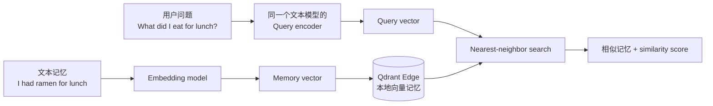
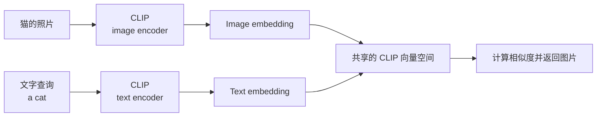
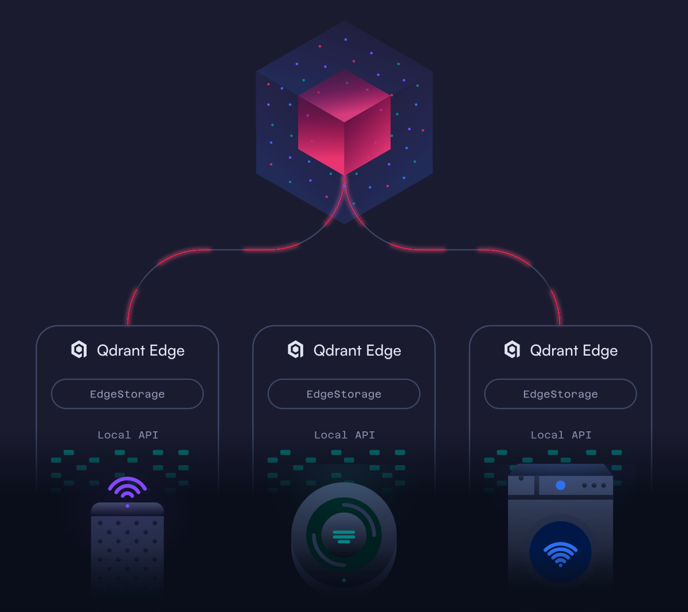

# 02. Overview of On-Device AI Memory：端侧记忆如何工作

> 课程：Building AI Assistants with On-Device Memory  
> 本课定位：理解文本与图像如何变成可检索的本地记忆  
> 前置笔记：[01 Introduction：给 AI 助手一套端侧记忆](01-introduction.md)  
> 主要材料：[02 transcript](../transcripts/02-overview-of-on-device-ai-memory.md) · [课程代码说明](../code/lessons/README.md) · [DeepLearning.AI 官方课程页](https://www.deeplearning.ai/courses/building-ai-assistants-with-on-device-memory)

## 1. 本课要回答的核心问题

上一课给出了 `Capture → Encode → Store → Recall → Forget` 的整体记忆循环。本课进一步回答两个具体问题：

1. 一条文本笔记或一张照片，如何变成设备能够按含义搜索的记忆？
2. 一个只保存了少量样例的机器人，如何在不调用 LLM、也不重新训练模型的情况下认出特定物体？

课程通过四个演示来建立直觉：

| 演示 | 说明的问题 |
| --- | --- |
| “最后在哪里看到我的手表？” | 记忆不仅保存对象，还保存每次看见它的时间与位置 |
| “I had ramen for lunch” | 查询与笔记不必使用相同措辞，系统可以按语义召回 |
| “Dylan's coffee mug” | 系统可以记住某个具体实例，而不只是“杯子”这一通用类别 |
| 教会机器人 Luna 玩偶 | 添加少量视觉样例，就能扩展设备的本地记忆 |

## 2. 文本如何变成可搜索记忆？

假设设备保存了一条笔记：

> I had ramen for lunch.

后来用户问：

> What did I eat for lunch?

两句话没有逐字匹配，但含义高度相关。要实现这种检索，系统执行以下流程：



### 2.1 Embedding 是什么？

**Embedding** 是由一组数字组成的向量，用来表示文本的语义特征。每个数字单独看通常没有直观含义；重要的是整个向量在向量空间中的位置。

语义相近的内容倾向于得到方向相近的向量。因此，“午餐吃了拉面”的记忆可以响应“午餐吃了什么”的问题，即使它们没有共享完整的关键词组合。

### 2.2 为什么记忆和问题要使用兼容的模型？

向量只有位于同一个表示空间中才可以比较。课程代码使用同一个 Nomic 文本模型处理文档和查询，但采用相应的 document/query 编码入口。查询不能换成一个无关模型随意编码，否则两个向量空间的坐标含义不一致，相似度也失去意义。

### 2.3 Vector search engine 做什么？

保存少量记忆时，可以逐条计算相似度；记忆数量增大后，这样做会越来越慢。课程把向量组织成可导航的搜索结构，使查询可以快速找到近似最近邻（approximate nearest neighbor），而不必每次机械遍历全部记忆。

检索过程可以概括为：

```text
问题 → query vector → 找到最接近的 memory vectors → 按 score 排序 → 返回候选
```

返回最接近向量的过程称为 **retrieval**。在本课程使用的度量下，结果越接近，similarity score 越高。

## 3. 课程代码如何实现文本检索？

> 本节是使用后续 notebook 对本课概念的代码印证；02 本身是概念视频，没有独立 notebook。

[L3 notebook](../code/lessons/L3/Lesson3.ipynb) 和 [`helper.py`](../code/lessons/helper.py) 给出了实际配置：

| 项目 | 课程实现 |
| --- | --- |
| 文本模型 | `nomic-ai/nomic-embed-text-v1.5` |
| 文本向量维度 | 768 |
| 向量空间名称 | `text` |
| 距离度量 | Cosine |
| 查询类型 | `Query.Nearest` |
| 本地记忆层 | Qdrant Edge shard |

核心代码逻辑可以压缩为：

```python
question_vector = embed_query(question)

hits = shard.query(
    QueryRequest(
        query=Query.Nearest(question_vector, using="text"),
        limit=3,
        with_payload=True,
    )
)
```

这里的 `limit=3` 表示返回三个最相近的候选；`with_payload=True` 则让结果同时带回原始笔记、时间、位置等 metadata。向量负责“按含义找到谁”，payload 负责“告诉应用找到了什么以及它发生在何时何地”。

## 4. 图像如何变成可搜索记忆？

文本模型只能解决文本空间内的比较。如果用户想用“a cat”搜索一张猫的照片，就需要文字和图像能够进入兼容的表示空间。本课程使用 **CLIP**：

- image encoder 将照片转换为图像向量；
- text encoder 将自然语言描述转换为查询向量；
- 两种向量位于可比较的共享空间中。



这就是“用文字搜索图片”能够成立的原因：系统不是先把文字画成图片，而是把文字和图片映射为可以比较的向量。

### 课程代码中的图像空间

后续实验使用：

| 项目 | 课程实现 |
| --- | --- |
| 图像模型 | `Qdrant/clip-ViT-B-32-vision` |
| 图片查询文本模型 | `Qdrant/clip-ViT-B-32-text` |
| 图像向量维度 | 512 |
| 向量空间名称 | `image` |
| 距离度量 | Cosine |

例如，[L3](../code/lessons/L3/Lesson3.ipynb) 会把 “a red bicycle” 通过 CLIP text encoder 编码，再到 `image` 向量空间中检索照片：

```python
description_vector = embed_query_clip("a red bicycle")

photo_hits = shard.query(
    QueryRequest(
        query=Query.Nearest(description_vector, using="image"),
        limit=1,
        with_payload=True,
    )
)
```

## 5. 为什么同一个问题可能需要编码两次？

课程后续会同时搜索文字记忆和照片。一个自然语言问题可能要走两条路径：

```text
自然语言问题
├─ Nomic query encoder → 768-d text vector → 搜索 text 空间
└─ CLIP text encoder  → 512-d image vector → 搜索 image 空间
```

这两个向量不能混用：它们来自不同模型、维度不同、表示空间也不同。相应地，文本检索分数与图像检索分数的数值尺度也可能不同，不能假设同一个 threshold 对两种模态都合适。

## 6. Retrieval 不等于 Recognition

本课把向量搜索进一步用于物体识别，但两者之间有一个关键差别。

### Retrieval：无论多不像，都会选出最近的候选

如果记忆库里只有自行车、相机和棋子，而摄像头看到一个从未学习过的玩偶，最近邻搜索仍会返回其中一个对象。它只是“现有记忆中最接近的”，不代表答案正确。

### Recognition：候选还必须超过阈值

```text
top score ≥ similarity threshold  → 接受：识别为已知对象
top score < similarity threshold  → 拒绝：标记为 unknown
```

因此，一个完整的识别系统至少包含两步：

1. 用 retrieval 找出最可能的已知记忆；
2. 用 threshold 判断这个候选是否足够可信。

视频中，Luna 玩偶在加入多个视角后，口述的界面分数上升到约 97。这个数字只是当次演示结果，不是可复制到所有模型和数据上的通用阈值。

在后续 [L5 notebook](../code/lessons/L5/Lesson5.ipynb) 中，课程会用已标注的 match/non-match 分数分布校准阈值。该实验的已知匹配最低分为 0.86、非匹配最高分为 0.74，示例阈值取 0.80；这些值是该实验数据与模型下的选择，新的应用仍需重新评估 false positive 与 false negative 的代价。

## 7. “教会一次”为什么不需要重新训练模型？

以 Luna 玩偶为例，教学过程实际上是：

1. 用户给对象命名；
2. 设备拍摄几个不同视角；
3. CLIP 把每张照片编码为一个向量；
4. 系统保存这些向量，并把 `Luna` 作为 label/metadata；
5. 新画面到来时，与这些已存向量比较；
6. 匹配成功后，可继续保存新的 sighting、时间和位置。

变化的是**记忆库中的样例向量和 metadata**，不是 CLIP 的模型权重。增加视角相当于扩大该对象在向量空间中的已知覆盖范围，因此新角度更有机会接近某个已存样例。

这也解释了课程所说的：

- 不需要为每个新对象重新训练模型；
- 不需要自建一条专用视觉训练流水线；
- 这个核心识别步骤不需要 LLM。

但“不需要 LLM”不等于“不使用 AI 模型”。系统仍依赖预训练的 embedding/CLIP 模型来生成向量。

## 8. 为什么把记忆放在设备上？

| 维度 | On-device memory | Cloud memory |
| --- | --- | --- |
| 网络 | 模型准备完成后可离线召回 | 通常需要网络连接 |
| 隐私 | 私人记忆可以留在设备内 | 数据需要上传或同步 |
| 延迟与可靠性 | 不等待网络往返；弱网下仍可工作 | 受网络质量与服务可用性影响 |
| 算力与容量 | 受设备计算、内存和存储限制 | 更容易扩展计算与存储 |
| 多设备共享 | 需要额外同步机制 | 天然适合集中共享 |

课程中的机器人没有连接互联网，只通过 Direct Wi-Fi 与手机通信。手机充当界面，embedding 与向量检索仍在机器人本地完成。

本地与云端并不是非此即彼。Qdrant Edge 可以在需要共享、更大容量或更多算力时与云端同步；课程主体先只使用本地检索，附录再演示混合架构。

课程提供的架构图展示了同一种 Qdrant Edge、EdgeStorage 和 Local API 组合如何部署在不同设备上：



## 9. 三个演示背后的数据结构

### 手表与咖啡杯

只有对象名称还无法回答“最后在哪里看到”。每次 sighting 至少需要保存：

```text
视觉向量 + 对象标签 + 时间 + 位置 + 可展示的图片/引用
```

查询“Where did you last see my watch?”时，系统先找到与手表对应的记忆，再利用时间信息选择最近一次记录，并返回位置。

### Luna 玩偶

Luna 不是“所有猫”这一抽象类别，而是用户教给设备的一个具体对象。多个视角共享同一个 label，但各自保留独立的视觉表示，从而支持实例级记忆。

### 新的 sighting

识别已有对象后，设备可以把当前画面作为新的 sighting 写回记忆。这样，系统不仅知道“这是什么”，还逐渐形成“何时、何地见过它”的历史。

## 10. 容易混淆的概念

1. **Embedding 不是摘要文本。** 它是一组适合相似度计算的数值表示，应用仍需保存可读内容或文件引用。
2. **语义检索不是关键词搜索。** 它可以召回措辞不同但含义相关的内容，也可能因语义模糊产生弱匹配。
3. **Approximate nearest neighbor 不是随便猜。** “Approximate”表示用高效索引近似寻找精确最近邻，以搜索速度换取可控的召回差异。
4. **最高分不等于正确答案。** 最近邻只有相对意义；绝对是否匹配还需要阈值。
5. **不同模型的 score 不能直接比较。** Nomic 文本空间和 CLIP 图像空间需要分别校准。
6. **增加向量不是训练模型。** 新样例改变记忆内容，不改变预训练模型参数。
7. **On-device 不排斥 cloud。** 本地优先与按需同步可以组合使用。

## 11. 本课小结

- 文本和图片先通过相应的 embedding model 转换为向量，再由 Qdrant Edge 在本地存储和检索。
- 文本记忆与文本问题需要进入同一个文本表示空间；用文字搜索图片则需要 CLIP 的跨模态共享空间。
- Retrieval 返回最近的候选；Recognition 还必须用经过校准的 threshold 拒绝弱匹配。
- 教会机器人一个新对象，本质上是添加带标签的多视角向量，而不是重新训练视觉模型。
- 时间、位置和名称等 metadata 让“相似内容”升级为有上下文、可追踪的经历。
- 端侧记忆强调离线、隐私和本地响应；云端则可以在共享、计算或存储扩展时作为补充。

## 12. 复习问题

1. 为什么 “I had ramen for lunch” 能回答 “What did I eat for lunch?”？
2. 为什么保存文本与编码查询时必须使用兼容的 embedding 空间？
3. Vector search engine 中的 retrieval 具体返回什么？
4. CLIP 为什么能让文字查询匹配照片？
5. 为什么搜索文字记忆和搜索图片时，同一个问题要分别编码？
6. 如果记忆库里没有正确对象，nearest-neighbor search 会发生什么？
7. similarity threshold 分别过高和过低时，会增加哪类错误？
8. 给 Luna 增加更多视角，为什么可能改善识别？这和模型训练有什么区别？
9. 要回答“最后在哪里看到咖啡杯”，除了视觉向量还需要哪些信息？
10. 哪些需求适合完全本地运行，哪些需求可能值得加入云端同步？

## 下一课

[03 Inside the AI Assistant Device](../transcripts/03-inside-the-ai-assistant-device.md) 会打开机器人，解释摄像头、计算设备、SSD、本地模型、Qdrant Edge 和手机界面如何组合成完整系统。

## 资料来源

- [02：Overview of On-Device AI Memory transcript](../transcripts/02-overview-of-on-device-ai-memory.md)
- [DeepLearning.AI 官方课程页](https://www.deeplearning.ai/courses/building-ai-assistants-with-on-device-memory)
- [课程代码 README](../code/lessons/README.md)
- [课程 embedding 与检索辅助代码](../code/lessons/helper.py)
- [L3：Building the Memory notebook](../code/lessons/L3/Lesson3.ipynb)
- [L5：Learning Through Memory notebook](../code/lessons/L5/Lesson5.ipynb)

