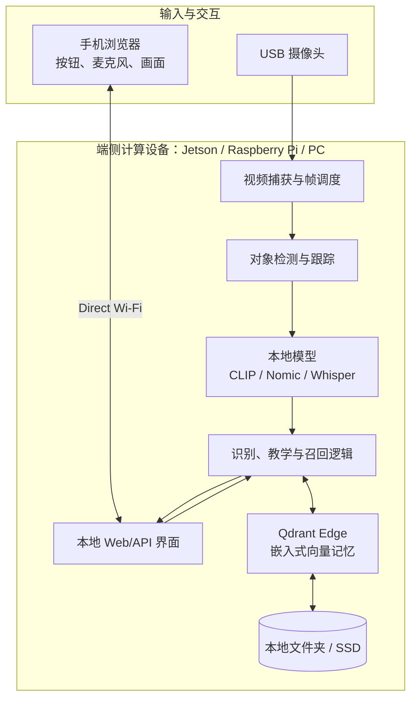
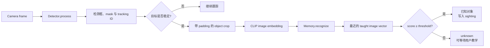
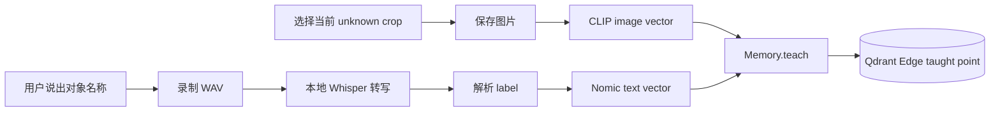

# 03. Inside the AI Assistant Device：拆开端侧 AI 助手

> 课程：Building AI Assistants with On-Device Memory  
> 本课定位：理解硬件、模型、本地记忆与交互界面如何协同工作  
> 前置笔记：[02 Overview of On-Device AI Memory](02-overview-of-on-device-ai-memory.md)  
> 主要材料：[03 transcript](../transcripts/03-inside-the-ai-assistant-device.md) · [课程代码 README](../code/README.md) · [官方设备仓库](https://github.com/https-deeplearning-ai/sc-on-device-ai-memory)

## 1. 本课的核心结论

这台机器人只是端侧记忆的一种物理实现。真正可复用的是它下面的系统分层：

```text
传感器 / 用户输入
        ↓
检测、跟踪与本地模型
        ↓
Qdrant Edge 本地向量记忆
        ↓
识别、教学、召回与遗忘
        ↓
手机或其他交互界面
```

摄像头、计算板、外壳和界面都可以替换。只要保留“捕获 → 编码 → 存储 → 召回”的记忆循环，同样的设计可以迁移到个人电脑（personal computer/PC）、Raspberry Pi 5、智能眼镜（smart glasses）、安防系统（security system）、家庭助手（home assistant）或野外设备。

## 2. 课程演示设备由什么组成？

| 组件 | 课程演示中的选择 | 职责 |
| --- | --- | --- |
| 计算设备 | NVIDIA Jetson Orin，8 GB 内存 | 运行检测、embedding、语音处理、向量检索和应用逻辑 |
| 持久存储 | SSD | 保存应用、模型缓存、Qdrant Edge shard、缩略图及配置 |
| 视觉输入 | USB 摄像头 | 持续提供视频帧 |
| 外壳 | 3D 打印外壳 | 固定计算板、SSD、摄像头与供电部件 |
| 用户界面 | 通过 Direct Wi-Fi 连接的手机 | 显示画面和记忆，触发教学、提问、重命名与遗忘 |

这台机器人本体没有麦克风、扬声器或屏幕。手机承担交互界面的职责，而图像处理、embedding 和向量检索仍留在机器人上。也可以把麦克风、扬声器或屏幕直接装到设备上；这会改变 I/O 形式，但不会改变记忆架构。

### 为什么使用手机界面？

- 减少机器人本体的外设和布线，使物理结构更紧凑；
- 复用手机已有的屏幕、麦克风和浏览器；
- Direct Wi-Fi 允许手机与机器人直接通信，不要求互联网连接；
- UI 与记忆逻辑解耦，之后可以换成桌面界面、语音按键或嵌入式屏幕。

## 3. 硬件与软件的完整分层



课程自带的通用 Qdrant Edge 架构图也强调：每台设备都可以在本地拥有自己的 EdgeStorage 与 Local API，而不必把每次检索发送到远程数据库。


## 4. “没有单独的向量数据库服务器”是什么意思？

课程中的 Qdrant Edge 是 **embedded vector search engine**：

- 它作为应用的一部分在设备上运行；
- 应用直接打开本地 shard 并执行写入、查询和删除；
- 记忆保存在设备文件夹中，而不是必须连接一个独立的 Qdrant 服务进程；
- 断电或应用重启后，可以重新加载磁盘上的 shard。

后续 [L3 notebook](../code/L3/Lesson3.ipynb) 会把 shard 创建在普通目录中：

```python
SHARD_DIR = "./mem_shard"
shard = EdgeShard.create(SHARD_DIR, config)
```

需要区分两种“server”：

| 组件 | 是否存在 | 作用 |
| --- | --- | --- |
| 独立向量数据库服务器 | 核心本地方案不需要 | 传统部署中通过网络提供向量数据库服务 |
| 本地 Web/UI 服务 | 可以存在 | 把画面、按钮和记忆页面提供给手机浏览器 |

因此，“没有数据库服务器”不等于应用没有任何网络接口。手机仍可通过本地连接访问界面，只是向量记忆与检索不依赖远程数据库或互联网。

## 5. 官方仓库如何组织这套系统？

> 以下细节来自课程的[官方设备仓库](https://github.com/https-deeplearning-ai/sc-on-device-ai-memory)及其[架构文档](https://github.com/https-deeplearning-ai/sc-on-device-ai-memory/blob/main/docs/architecture.md)，用于补足视频中的系统视图。

官方代码遵循一个重要依赖规则：

```text
robot/device  ──可以引用──>  robot/brain
robot/brain   ──不能引用──>  robot/device
```

这意味着“记忆大脑”不依赖某个具体摄像头、网页、Web server 或线程实现，可以单独理解和测试。

| 位置 | 职责 |
| --- | --- |
| `robot/brain/core.py` | 串联逐帧识别循环，以及 teach/ask 两个语音动作 |
| `robot/brain/memory.py` | Qdrant Edge schema、写入、识别查询和召回查询 |
| `robot/brain/models.py` | 延迟加载 CLIP、Nomic 和 Whisper |
| `robot/brain/detect.py` | 对象检测、跟踪、mask/crop 与稳定性判断 |
| `robot/device/live.py` | 摄像头、worker、按键和 brain 之间的桥梁 |
| `robot/device/server.py` | 面向手机浏览器的本地 HTTP 路由 |
| `robot/device/page.html` | 手机上的交互界面 |
| `robot/app.py` | 配置、启动和文件回放入口 |

这种分层使课程的 notebook memory 能够升级成持续运行的设备：notebook 负责展示单次存储和检索，设备代码则在实时视频循环中反复执行同一组操作。

## 6. 从 camera frame 到一次识别

官方仓库中的识别流程是：



这里有三个值得注意的设计：

1. **先跟踪，再查询。** 系统等待对象轨迹稳定后再生成 crop 和搜索记忆，避免对每一帧中的抖动区域重复检索。
2. **检测器不决定对象身份。** 当前实现使用 YOLOE 提出对象区域并用 BoT-SORT 跟踪，但丢弃 detector 的类别标签。
3. **身份来自记忆。** 具体对象名称由 CLIP embedding、Qdrant Edge 最近邻和 recognition threshold 共同决定。

因此，系统可以学习“Dylan 的咖啡杯”或“Luna”这样的具体实例，而不局限于 detector 原本训练过的通用类别。

## 7. 教学流程：从未知对象到一条 taught memory

当画面中出现稳定的未知对象时，用户可以触发教学：



一条 taught view 同时包含：

- 用于视觉识别的 CLIP image vector；
- 用于按名称或含义召回的 Nomic text vector；
- 人类可读的 label、语音 transcript、时间和缩略图等 payload。

再次教学同一个 label 时，系统会增加一个新的 point，而不是覆盖第一个视角。识别时会在所有已教视角中寻找最近结果，所以两三个不同角度通常比单一图片更有覆盖力。

## 8. 召回流程：从问题到最近一次 sighting

当用户问“最后在哪里看到我的手表？”时，系统执行：

```text
手机录音
  → 本地 Whisper 转成文字
  → Nomic 生成 query vector
  → 在 taught memories 中确定用户问的是哪个对象
  → 查找该对象按时间排序的 sightings
  → 从 payload 返回 label、time、location 和 thumbnail
```

如果问题明确包含一个已经教过的名称，当前官方实现会优先按名称缩小候选，避免一个语义相似但名称不同的对象替换用户明确指定的目标。

最终回答来自已存储的 payload；这里没有 LLM 临时编造一段答案。能否正确回答依赖于之前是否捕获并保存了合适的 sighting 及其时间、位置等上下文。

## 9. 设备中的三类记忆

官方架构把一个 Qdrant Edge shard 放在 `edge-data/`，并使用三种 `kind`：

| `kind` | 向量 | 用途 |
| --- | --- | --- |
| `taught` | `image` + `text` | 用户命名过的样例视角，是对象身份的依据 |
| `seen` | `image` | 已知对象后来再次出现时产生的 sighting |
| `ignored` | `image` | 用户决定忽略的干扰物，使其继续保持隐藏 |

向量配置与 notebook 保持一致：

- `image`：512 维 CLIP vector，Cosine distance；
- `text`：768 维 Nomic vector，Cosine distance。

payload 可保存 `label`、`transcript`、`timestamp`、`location` 和 thumbnail path。它们分别回答两个不同问题：

```text
向量：这次输入最像哪条记忆？
Payload：这条记忆叫什么、何时发生、在哪里、要展示什么？
```

### Rename、Forget 与 Drop view 的区别

| 操作 | 含义 |
| --- | --- |
| Rename | 修改人类可读名称，使后续界面和召回使用新 label |
| Drop a view | 删除某个错误或质量不佳的样例视角，保留该对象的其他表示 |
| Forget | 删除整个对象及相关记忆，使它重新变成 unknown |

这说明设备记忆不是黑盒模型权重，而是用户可以查看、修正和删除的数据。

## 10. 为什么要把运行任务拆开？

实时摄像头应用不能在主画面线程中顺序完成所有重计算，否则 embedding 或语音转写会让画面卡顿。官方实现把工作拆成四类：

| 运行任务 | 主要职责 |
| --- | --- |
| Main loop | 读取帧、绘制检测框并发布 JPEG 画面 |
| Detection worker | 运行检测、生成 crop embedding 并查询记忆 |
| Key worker | 按顺序处理按钮和键盘动作 |
| Voice worker | 接收或录制语音，转写后执行 teach/ask |

Qdrant shard 的访问由 `Memory` 串行化，防止多个 worker 同时读写造成状态冲突。这个并发结构属于实时设备实现，而不是记忆算法本身；把 `robot/brain` 与 `robot/device` 分离后，可以在 notebook 或离线测试中绕过这些设备复杂度。

## 11. 持久化与断电设计

物理机器人可能直接拔电关机，因此“写入后仍存在”比 notebook 中的临时变量更重要。官方架构中的处理包括：

- shard、缩略图和位置数据写入 `edge-data/`；
- embedding 模型下载后缓存在本机；
- 每次写入后主动 flush；
- 可以关闭并重新加载 shard，以确认召回来自磁盘而非进程内缓存；
- `.env` 保存与摄像头、识别和检测有关的配置。

这也是 on-device memory 与普通实时识别演示的区别：后者可能只知道“这一帧里有什么”，而前者会把经历跨重启保留下来。

## 12. Headless 与硬件可替换性

**Headless** 指设备无需长期连接显示器、键盘或鼠标即可启动和运行。完成初次安装与配置后，机器人可以自动启动应用，再通过手机或网络界面控制。

课程仓库还提供：

- Get Started 和完整设置指南；
- 硬件零件清单；
- 相机校准与手机连接说明；
- headless 设置说明；
- 3MF/STL 外壳打印文件与组装指南；
- 可继续修改的外壳设计资源。

选择不同设备时，应先分离“不会变化的记忆循环”和“需要适配的设备层”：

| 通常保持不变 | 通常需要适配 |
| --- | --- |
| embedding → vector store → retrieval | 摄像头驱动和分辨率 |
| taught/seen/ignored 的记忆语义 | 算力、模型速度和帧率 |
| threshold 后的已知/未知判断 | 麦克风、按钮或浏览器 UI |
| label、时间、位置等 payload | 电源、外壳和启动方式 |

## 13. 从机器人迁移到其他设备

| 使用场景 | 输入 | 应该记住什么 | 可能的界面 |
| --- | --- | --- | --- |
| 智能眼镜 | 第一视角摄像头、语音 | 物品最后出现的位置与时间 | 语音或手机 |
| 家庭助手 | 室内摄像头、麦克风 | 家中物体、事件和用户笔记 | 扬声器或屏幕 |
| 安防系统 | 固定摄像头 | 允许/未知对象及 sightings | 运维面板 |
| 野外设备 | 相机和环境传感器 | 现场样本、异常和时间地点 | 本地按钮或间歇同步 |
| 个人电脑 | Webcam、麦克风 | 用户教过的对象和日常记录 | 本地网页 |

迁移时最先要回答的不是“买哪块板”，而是：设备要捕获什么、哪些经历值得写入、多久写一次、如何判断匹配，以及用户如何查看或删除记忆。

## 14. 容易混淆的概念

1. **机器人不是课程目标本身。** 它只是把通用记忆循环放进一个连续运行的物理载体。
2. **手机是界面，不是计算中心。** 课程演示的 embedding 与向量检索仍在机器人上执行。
3. **对象检测不等于对象记忆。** Detector 找区域，CLIP 与 Qdrant Edge 判断它像哪条用户记忆。
4. **本地运行不等于没有网络。** Direct Wi-Fi 可以承担本地通信，但不需要互联网或远程 API。
5. **嵌入式数据库不等于只存在内存。** Shard 持久化在磁盘目录中，可在重启后重新加载。
6. **增加屏幕或麦克风不会改变核心 memory schema。** 它们只改变输入和输出通道。
7. **Drop view 不等于 Forget object。** 前者清理一个样例，后者移除整个对象记忆。

## 15. 课程编号提示

下载材料存在两套编号：

- transcript 把 Introduction 计为 01，因此下一段视频是 [04 Building the Memory](../transcripts/04-building-the-memory.md)；
- notebook 课程编号从核心课程单元计数，对应代码是 [L3/Lesson3.ipynb](../code/L3/Lesson3.ipynb)。

二者内容对应，不是缺少了一个 notebook。

## 16. 本课小结

- 端侧助手由传感器、端侧计算、本地模型、嵌入式向量记忆和可替换界面组成。
- Qdrant Edge 在应用进程中直接打开磁盘 shard，无需独立远程向量数据库服务器。
- Detector 负责发现和跟踪区域；CLIP、Qdrant Edge 与 threshold 负责基于记忆识别具体对象。
- Teaching 写入带标签的多视角记忆；Recognition 匹配这些记忆；Recall 再从 sightings 中取回时间和位置。
- 手机通过 Direct Wi-Fi 提供 UI，但计算与私人记忆留在设备上。
- `robot/brain` 与 `robot/device` 解耦，使同一记忆逻辑能够迁移到不同硬件和界面。
- 课程真正要构建的是可持久化、可检查、可修正、可遗忘的 memory loop，而不是复制某一台机器人。

## 17. 复习问题

1. 为什么这台机器人没有屏幕、麦克风和扬声器仍然可以完成教学与召回？
2. “Qdrant Edge 没有独立数据库服务器”与“手机能打开 Web 界面”是否矛盾？
3. 对象检测、视觉 embedding 和 memory recognition 分别负责什么？
4. 为什么系统要等待 tracked object 稳定后再查询记忆？
5. 一条 `taught` point 与一条 `seen` point 的数据和职责有什么不同？
6. 为什么同一对象保存多个视角比只保留一张图片更可靠？
7. 要回答“最后在哪里看到它”，payload 至少需要保存哪些字段？
8. Rename、Drop view 与 Forget 分别适合什么情况？
9. `robot/brain` 不反向依赖 `robot/device` 带来了什么好处？
10. 如果把系统迁移到智能眼镜，哪些部分可以复用，哪些部分必须重新适配？

## 下一课

下一步将真正创建本地 shard，存储文本和图片，进行语义检索、metadata filtering 与删除：

- 视频 transcript：[04 Building the Memory](../transcripts/04-building-the-memory.md)
- 对应 notebook：[L3/Lesson3.ipynb](../code/L3/Lesson3.ipynb)

## 资料来源

- [03：Inside the AI Assistant Device transcript](../transcripts/03-inside-the-ai-assistant-device.md)
- [课程 notebooks README](../code/README.md)
- [官方设备仓库：sc-on-device-ai-memory](https://github.com/https-deeplearning-ai/sc-on-device-ai-memory)
- [官方架构文档：Understand the Architecture](https://github.com/https-deeplearning-ai/sc-on-device-ai-memory/blob/main/docs/architecture.md)
- [官方硬件文档](https://github.com/https-deeplearning-ai/sc-on-device-ai-memory/blob/main/docs/hardware.md)
- [官方硬件清单](https://github.com/https-deeplearning-ai/sc-on-device-ai-memory/blob/main/docs/hardware-parts.md)

