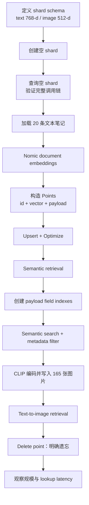
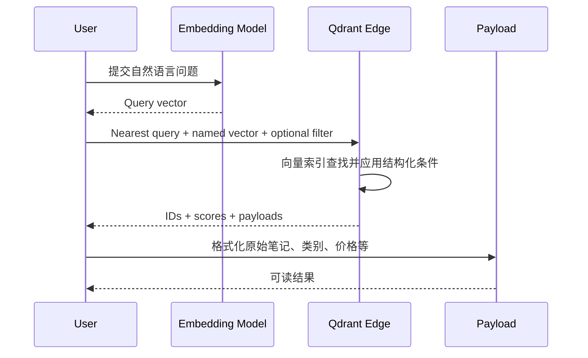

# 04. Building the Memory：从零构建本地多模态记忆

> 课程：Building AI Assistants with On-Device Memory  
> 本课定位：第一节动手实验——存储、检索、过滤和遗忘文本与图像记忆  
> 前置笔记：[03 Inside the AI Assistant Device](03-inside-the-ai-assistant-device.md)  
> 主要材料：[04 transcript](../transcripts/04-building-the-memory.md) · [L3 notebook](../code/lessons/L3/Lesson3.ipynb) · [`helper.py`](../code/lessons/helper.py)

## 1. 编号说明与学习目标

下载材料使用了两套编号：

- transcript 把 Introduction 计为 01，所以本节是 `04-building-the-memory.md`；
- notebook 按核心课程单元编号，所以配套代码位于 `L3/Lesson3.ipynb`。

两者讲的是同一节课。本实验最终会得到一个本地 Qdrant Edge shard，它可以：

- 存储和检索 20 条文本记忆；
- 用 metadata 同时限制类别和价格；
- 在同一个 shard 中再保存 165 张图片；
- 用自然语言描述搜索图片；
- 明确删除一条记忆；
- 理解向量数量增长时的 lookup latency 变化。

## 2. 实验全景



这节实验把“记忆”落实为一个可操作的数据结构：

```text
Memory Point = ID + Named Vector(s) + Payload
```

- **ID：** 唯一标识一条记忆，供更新或删除使用；
- **Named vector：** 用于相似度检索，可以是 `text`、`image` 或二者；
- **Payload：** 保存原始内容及类别、位置、时间、价格等结构化上下文。

## 3. 运行前准备

课程 README 建议使用 Python 3.12 或更新版本，并从 [`requirements.txt`](../code/lessons/requirements.txt) 安装固定版本依赖。课程保存输出使用 `qdrant-edge-py==0.7.2` 和 `fastembed==0.8.0`。

打开 notebook 时，应确保它按课程布局在 [`code/lessons/L3/`](../code/lessons/L3/) 中运行，因为代码使用相对路径：

```text
./mem_shard
./ro_shared_data/memories.json
./ro_shared_data/bank
```

首次调用 embedding model 可能需要下载模型；缓存完成后，后续实验不需要 API key，也可以离线运行。

> **重要：** notebook 开头的 `fresh_start("./mem_shard")` 会删除同名旧 shard，再创建空目录。不要把想保留的数据放在这个实验目录中。

## 4. Step 1：定义并创建空 shard

```python
from helper import *
from qdrant_edge import (
    Distance,
    EdgeConfig,
    EdgeShard,
    EdgeVectorParams,
    Query,
    QueryRequest,
)

SHARD_DIR = fresh_start("./mem_shard")

config = EdgeConfig(
    vectors={
        "text": EdgeVectorParams(size=768, distance=Distance.Cosine),
        "image": EdgeVectorParams(size=512, distance=Distance.Cosine),
    }
)
shard = EdgeShard.create(SHARD_DIR, config)
```

预期输出：

```text
Empty shard created at ./mem_shard
```

### 4.1 为什么要预先声明 schema？

向量数据库必须知道每个向量空间的维度与距离度量，才能验证写入并建立适合的索引：

| Named vector | 模型 | 维度 | Distance | 用途 |
| --- | --- | ---: | --- | --- |
| `text` | Nomic text embedding | 768 | Cosine | 文本笔记与文字问题 |
| `image` | CLIP ViT-B/32 | 512 | Cosine | 图片与自然语言图片描述 |

`text` 和 `image` 是两个独立的向量空间。768 维文本向量不能拿去搜索 512 维图片空间；即使维度碰巧相同，不同模型的坐标语义也不能随意混用。

### 4.2 Shard、collection 与目录

本课程把 shard 也称为 collection。对本地 Qdrant Edge 来说，它实际落在一个磁盘目录中。应用直接打开这个目录完成写入和查询，不需要单独启动远程向量数据库服务。

## 5. Step 2：先查询空记忆

```python
question = "a good place to eat or drink nearby"
question_vector = embed_query(question)

hits = shard.query(
    QueryRequest(
        query=Query.Nearest(question_vector, using="text"),
        limit=3,
        with_payload=True,
    )
)
```

notebook 显示：

```text
Closest memories
"a good place to eat or drink nearby"
Nothing stored yet.
```

空查询不是多余步骤。它提前验证了以下路径可以正常运行：

```text
文字问题 → query embedding → Qdrant query → 结果格式化
```

如果这时就出错，问题通常位于模型加载、向量维度、shard 配置或调用参数，而不是后面的数据内容。

## 6. Step 3：加载文本记忆

课程数据文件 [`memories.json`](../code/lessons/ro_shared_data/memories.json) 一共有 42 条跨模态记录：

| `source_type` | 数量 |
| --- | ---: |
| `text` | 20 |
| `voice` | 5 |
| `photo` | 17 |

本节先只保留文本：

```python
notes = load_memories(
    "./ro_shared_data/memories.json",
    source_type="text",
)
```

20 条文本笔记覆盖以下类别：

| Category | 数量 |
| --- | ---: |
| work | 5 |
| food | 4 |
| errands | 3 |
| health | 2 |
| home | 2 |
| social | 2 |
| shopping | 1 |
| travel | 1 |

每条记录除了 `note`，还可能带有：

```json
{
  "id": 0,
  "source_type": "text",
  "category": "food",
  "location": "5th St",
  "timestamp": 1694679480,
  "note": "Great little coffee place on 5th with outdoor seating and fast wifi",
  "price": 6.0
}
```

并非每条记录都有 `price`。Payload 可以具有不同字段，而向量 schema 仍保持不变。

## 7. Step 4：把笔记编码为向量

```python
vectors = embed_text([m["note"] for m in notes])
```

`embed_text` 使用课程固定的 Nomic 模型，把 20 条笔记分别转换为 768 维向量。notebook 对第一条向量只展示前几个数字：

```text
[-0.677, +0.533, -4.308, -0.206, +0.082, -0.265, -0.431, +0.264, ...]
768 dimensions
```

### Document embedding 与 query embedding

课程辅助代码有两个入口：

```python
embed_text(notes)       # 为要保存的 documents 编码
embed_query(question)   # 为查询编码
```

它们使用兼容的 Nomic 模型空间，但查询入口会应用适合 query 的任务前缀。不要因为输入都是字符串，就把二者当成完全可交换的函数。

## 8. Step 5：构造并写入 Points

```python
from qdrant_edge import Point, UpdateOperation

points = [
    Point(id=m["id"], vector={"text": vector}, payload=m)
    for m, vector in zip(notes, vectors)
]

shard.update(UpdateOperation.upsert_points(points))
shard.optimize()
```

预期输出：

```text
Stored 20 memories
```

第一条 point 的结构为：

| Field | Value |
| --- | --- |
| id | `0` |
| vector | `text: 768 dimensions` |
| source_type | `text` |
| category | `food` |
| location | `5th St` |
| timestamp | `1694679480`（Sep 14, 08:18） |
| note | `Great little coffee place on 5th with outdoor seating and fast wifi` |
| price | `6.0` |

### Upsert 与 optimize

- **Upsert：** ID 不存在时新增 point；同一 ID 已存在时更新对应 point。
- **Optimize：** 整理并准备 shard 的搜索结构，使后续查询高效执行。

实验在批量写入后调用 `optimize()`，而不是每写一条就立即优化一次。

## 9. Step 6：执行第一次语义检索

再次使用同一个问题：

```text
a good place to eat or drink nearby
```

notebook 保存的前三名为：

| Rank | Score | Category | Price | Memory |
| ---: | ---: | --- | ---: | --- |
| 1 | 0.587 | food | $6 | Great little coffee place on 5th with outdoor seating and fast wifi |
| 2 | 0.571 | work | $14 | Found a quiet cafe with good wifi to work from near the park |
| 3 | 0.530 | food | $3 | Coffee run to the espresso bar near the office |

这一阶段没有 category 或 price 限制，排序只回答：哪些文本向量在语义上最接近问题？

第二名虽然 category 是 `work`，但文本包含 cafe 与 good wifi，因此在“适合吃喝的地方”这一语义查询中仍然很接近。这正是后面需要 metadata filter 的原因。

## 10. Step 7：为 Payload 建立字段索引

```python
from qdrant_edge import PayloadSchemaType

shard.update(UpdateOperation.create_field_index(
    "category", PayloadSchemaType.Keyword
))
shard.update(UpdateOperation.create_field_index(
    "price", PayloadSchemaType.Float
))

shard.optimize()
```

预期输出：

```text
Indexed category and price
```

Payload 在没有 field index 时仍会随 point 保存，但对需要频繁过滤的字段建立正确类型的索引，可以让过滤更高效。

字段类型必须匹配查询方式：

- `category` 是离散标签，使用 `Keyword`；
- `price` 需要数值范围比较，使用 `Float`。

## 11. Step 8：组合语义检索与硬过滤

目标是寻找：

```text
语义上适合吃饭或喝东西
AND category == "food"
AND price < 15
```

```python
from qdrant_edge import (
    FieldCondition,
    Filter,
    MatchValue,
    RangeFloat,
)

cheap_food = Filter(
    must=[
        FieldCondition(
            key="category",
            match=MatchValue(value="food"),
        ),
        FieldCondition(
            key="price",
            range=RangeFloat(lt=15),
        ),
    ]
)

hits_filtered = text_search(shard, question, cheap_food)
```

`must` 中的条件全部需要满足，相当于逻辑 AND。`lt=15` 是严格小于 15，而不是小于等于 15。

过滤后的结果为：

| Rank | Score | Category | Price | Memory |
| ---: | ---: | --- | ---: | --- |
| 1 | 0.587 | food | $6 | Great little coffee place on 5th with outdoor seating and fast wifi |
| 2 | 0.530 | food | $3 | Coffee run to the espresso bar near the office |
| 3 | 0.454 | food | $4 | New bakery on the corner does an amazing morning cronut |

原本分数为 0.571 的公园咖啡馆被排除，不是因为语义不相关或价格过高，而是它的 category 是 `work`。

### Filter 与 similarity 各自负责什么？

| 机制 | 负责的问题 |
| --- | --- |
| Metadata filter | 哪些候选满足不可妥协的结构化条件？ |
| Vector similarity | 在满足条件的候选中，哪些内容与问题语义最接近？ |

两者是互补关系，不是替代关系。向量模型不应负责精确执行价格上限，metadata filter 也无法判断一条笔记是否在含义上回答了问题。

## 12. Step 9：向同一个 shard 加入图片

课程的 [`bank/`](../code/lessons/ro_shared_data/bank/) 目录包含 165 张对象图片。辅助函数执行：

```python
store_photos(shard, "./ro_shared_data/bank")
```

其内部逻辑可以概括为：

```python
photos = sorted(Path(folder).glob("*.jpg"))
vectors = embed_image([str(path) for path in photos])

points = [
    Point(
        id=1000 + i,
        vector={"image": vector},
        payload={"file": path.name, "source_type": "photo"},
    )
    for i, (path, vector) in enumerate(zip(photos, vectors))
]
```

写入后：

```text
20 text memories + 165 photo memories = 185 memories
```

### Named vectors 的关键作用

同一个 shard 拥有 `text` 和 `image` 两个向量空间，但不代表每条 point 必须拥有两个向量：

| Point 类型 | 拥有的 vector | Payload 示例 |
| --- | --- | --- |
| 文本笔记 | `text` | note、category、location、timestamp、price |
| 图片 | `image` | file、source_type |

查询时用 `using="text"` 或 `using="image"` 明确选择空间。文本查询不会因为图片与文本在同一个 shard 就自动检索图片；它必须通过 CLIP text encoder 进入 `image` 空间。

## 13. Step 10：用自然语言搜索图片

```python
my_description = "a red bicycle"
description_vector = embed_query_clip(my_description)

photo_hits = shard.query(
    QueryRequest(
        query=Query.Nearest(description_vector, using="image"),
        limit=1,
        with_payload=True,
    )
)
```

notebook 返回一张红色自行车图片。

这里使用的是 CLIP 的 text encoder，而不是 Nomic：

```text
"a red bicycle"
  → CLIP text embedding（512-d）
  → 在 image named vector 中查询
  → 返回最相近的 CLIP image embedding
```

文本没有先被生成成图片。CLIP 只是把文字描述和照片映射进可比较的共享空间。

## 14. Step 11：明确遗忘一条记忆

```python
forgotten = hits[0]

shard.update(
    UpdateOperation.delete_points([forgotten.id])
)
shard.optimize()
```

预期输出：

```text
Forgot id 0: Great little coffee place on 5th with outdoor seating and fast wifi
```

删除前后对比：

| 状态 | Score | Memory |
| --- | ---: | --- |
| Before #1 | 0.587 | Great little coffee place on 5th... |
| Before #2 / After #1 | 0.571 | Found a quiet cafe with good wifi... |
| Before #3 / After #2 | 0.530 | Coffee run to the espresso bar... |
| After #3 | 0.490 | Try the new ramen place downtown... |

删除第一名后，其余 point 的向量没有改变，因此原第二、第三名的分数仍是 0.571 和 0.530。变化的是可供返回的候选集合，而不是对其他记忆重新计算出不同表示。

### Filtering 与 Forgetting 的差别

| 操作 | 影响范围 | 记忆是否仍存在 |
| --- | --- | --- |
| Filter | 只影响当前查询或使用该 filter 的查询 | 是 |
| Delete / Forget | 从 shard 删除 point，后续查询都不可返回 | 否 |

如果只是“不想在这次查询中看到”，应使用 filter；如果用户要求系统真正忘记，应删除相应 point。

## 15. Step 12：理解 Search Latency

notebook 的曲线不是在每次课程运行时现场测量，而是使用课程保存的基准数据绘制：

| Memories | Vector lookup median |
| ---: | ---: |
| 1,000 | 0.054 ms |
| 5,000 | 0.179 ms |
| 25,000 | 0.526 ms |
| 100,000 | 1.439 ms |
| 250,000 | 2.646 ms |

查询 embedding 的保存基准约为 5.5 ms，图中以水平虚线表示。

**测量条件：** Apple M5 Pro、CPU-only、Python 3.14.6，每种规模执行 300 次查询并报告中位数。

### 如何解读？

- 记忆量从 1,000 增长到 250,000，扩大 250 倍；
- lookup 从 0.054 ms 增至 2.646 ms，约扩大 49 倍；
- 在这组数据中，即使到 250,000 条，query embedding 仍比单次 vector lookup 更耗时；
- 这体现了向量索引的扩展能力，但不是所有设备、模型和数据分布下的性能保证。

如果更换 CPU、向量维度、Qdrant Edge 版本、索引状态或查询参数，都应重新测量，而不是直接复用表中的数字。

## 16. 一次完整 Recall 的成本与数据流



从性能上看，一次本地召回至少包含两个主要部分：

1. **Query embedding：** 与记忆数量基本无关，但受模型与硬件影响；
2. **Vector lookup：** 随索引规模增加，但借助向量搜索结构避免简单线性扫描。

网络往返不在这张课程曲线中，因为实验完全在设备本地执行。

## 17. 运行 notebook 时的常见问题

### 问题 1：找不到 `ro_shared_data`

原因通常是工作目录不正确。相对路径按 `L3/` 解析；确认 notebook 位于课程提供的目录结构中运行。

### 问题 2：重新运行第一格后，之前的记忆消失

这是预期行为。`fresh_start("./mem_shard")` 会清空该实验 shard，保证课程能够从一致状态重新开始。

### 问题 3：向量维度不匹配

`text` 必须接收 768 维 Nomic vector，`image` 必须接收 512 维 CLIP vector。还要确认查询的 `using` 名称与向量类型一致。

### 问题 4：文本查不到图片

普通 `embed_query` 产生 Nomic 文本向量，只能搜索 `text` 空间。要用文字搜图，必须使用 `embed_query_clip` 并查询 `image` 空间。

### 问题 5：过滤结果比预期少

检查以下几点：

- `must` 中的条件是否都能满足；
- `lt=15` 是否误以为包含 15；
- category 字符串是否完全匹配；
- 记录是否实际带有 `price` 字段；
- field index 类型是否与 payload 类型一致。

### 问题 6：重复执行删除 cell

`forgotten = hits[0]` 使用前面查询保存的 `hits`。如果乱序或重复运行 cells，变量可能指向已删除的 point。实验出现状态混乱时，从创建空 shard 的 cell 顺序重跑。

### 问题 7：第一次 embedding 很慢或无法离线运行

模型需要先下载并缓存。确认联网完成首次准备后，再测试离线运行。

## 18. 建议动手修改

完成原 notebook 后，可以用以下小实验检查理解：

1. 把问题改为 `something I need to do before Friday`，观察语义检索是否找到干洗笔记。
2. 只保留 `category == "food"`，比较有无 price 条件时的候选变化。
3. 将 `lt=15` 改成更严格的价格范围，预测结果后再运行。
4. 将图片描述改成另一个确实存在于 [`bank/`](../code/lessons/ro_shared_data/bank/) 的对象，观察返回图片。
5. 删除非第一名记忆，验证未删除结果的相似度分数仍然不变。
6. 关闭并重新打开已有 shard，验证磁盘持久化；不要在前面再次调用 `fresh_start`。

## 19. 术语速查

| 术语 | 本实验中的含义 |
| --- | --- |
| Shard / Collection | 保存向量、payload 和索引的本地记忆目录 |
| Named vector | 一个 point 中带名称的向量空间，如 `text` 或 `image` |
| Point | ID、一个或多个 vectors 及 payload 的组合 |
| Payload | 与向量关联的原始内容和结构化 metadata |
| Upsert | ID 不存在则插入，存在则更新 |
| Optimize | 整理并准备适合查询的 shard 搜索结构 |
| Field index | 为 payload 字段建立的过滤索引 |
| Semantic retrieval | 按向量语义相似度找回记忆 |
| Hard filter | category、price 等必须满足的结构化条件 |
| Forget | 删除 point，使它不再参与任何后续检索 |

## 20. 本课小结

- Qdrant Edge shard 可以配置多个 named vector spaces，在同一记忆库中容纳文本和图片。
- 文本笔记通过 Nomic 变成 768 维向量；图片和图片描述通过 CLIP 进入 512 维共享空间。
- Point 将向量检索所需的数据与用户可读的 payload 组合在一起。
- Semantic similarity 负责“含义接近”，metadata filter 负责类别和价格等硬约束。
- Filter 不会删除数据；`delete_points` 才是本课中的明确遗忘。
- 删除一条 point 不会改变其他 point 的向量或相似度分数，只会改变可返回候选。
- Lookup latency 随记忆规模增加，但课程基准中增长速度低于数据量增长；具体数值必须结合测量硬件理解。

## 21. 复习问题

1. 为什么创建 shard 时必须预先声明 vector name、dimension 和 distance？
2. `embed_text` 与 `embed_query` 为什么不应随意互换？
3. 一条 Qdrant Point 由哪些部分组成？
4. 为什么第二名的公园咖啡馆在添加 filter 后消失？
5. `must` 中的 category 和 price 条件是什么逻辑关系？
6. 为什么 Nomic query vector 不能直接搜索 CLIP image vectors？
7. 同一 shard 中的文本 point 为什么可以没有 `image` vector？
8. Filter 和 Delete 在用户体验与数据状态上有什么根本区别？
9. 删除第一名后，为什么其余结果的 score 没有变化？
10. Latency 图为什么要把 query embedding 与 vector lookup 分开？

## 下一课

下一节会把文本、语音和照片合并成一天的记忆，并构建可以用文字或语音提问的助手：

- 视频 transcript：[05 Building the Voice Assistant](../transcripts/05-building-the-voice-assistant.md)
- 对应 notebook：[L4/Lesson4.ipynb](../code/lessons/L4/Lesson4.ipynb)

## 资料来源

- [04：Building the Memory transcript](../transcripts/04-building-the-memory.md)
- [L3：Building the Memory notebook](../code/lessons/L3/Lesson3.ipynb)
- [课程辅助函数](../code/lessons/helper.py)
- [课程综合记忆数据](../code/lessons/ro_shared_data/memories.json)
- [课程图片库](../code/lessons/ro_shared_data/bank/)
- [课程运行说明与依赖](../code/lessons/README.md)

