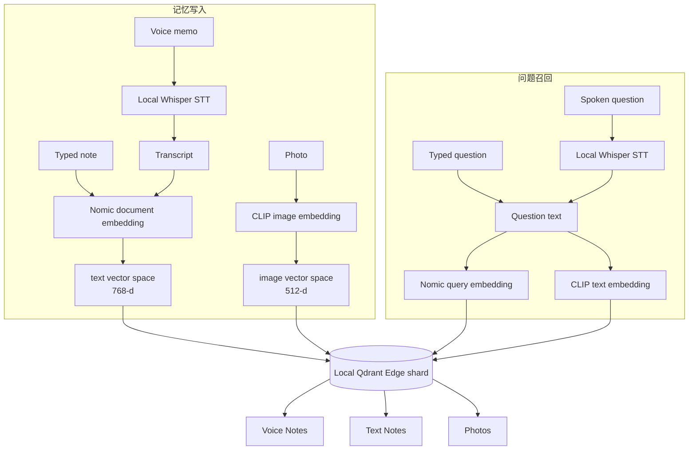

# 05. Building the Voice Assistant：构建可用语音提问的本地多模态记忆助手

> 课程：Building AI Assistants with On-Device Memory  
> 本课定位：第二节动手实验——把照片、文本笔记和语音笔记合并进一个本地记忆助手  
> 前置笔记：[04 Building the Memory](04-building-the-memory.md)  
> 主要材料：[05 transcript](../transcripts/05-building-the-voice-assistant.md) · [L4 notebook](../code/L4/Lesson4.ipynb) · [`helper.py`](../code/helper.py)

## 1. 编号说明与学习目标

下载材料仍然使用两套编号：

- transcript 把 Introduction 计为 01，因此本节是 `05-building-the-voice-assistant.md`；
- notebook 按核心课程单元编号，因此配套实验是 `L4/Lesson4.ipynb`。

上一课已经建立了包含 `text` 与 `image` 两个 named vector spaces 的本地 Qdrant Edge shard。本课在此基础上加入本地语音转写，并把三个来源统一到一个召回入口中：

1. 加载一天中的 42 条照片、文本与语音记忆；
2. 使用本地 Whisper 把语音笔记转写成文字；
3. 把文本和语音 transcript 写入 Nomic 文本向量空间；
4. 把照片写入 CLIP 图像向量空间；
5. 用同一个 `recall(question)` 接收键盘问题或转写后的语音问题；
6. 向 shard 新增一条记忆，并立即将它召回。

这节课的重点不是“语音界面”本身，而是理解：**语音经过转写后，可以复用已有的文本记忆管线。**

## 2. 先准确理解这里的“Voice Assistant”

本课构建的是一个可以接受语音问题的本地记忆检索助手，完整能力是：

```text
语音输入 → Speech-to-Text → Semantic Retrieval → 展示相关原始记忆
```

它还不包含：

- 使用 LLM 综合多条记忆生成自然语言答案；
- Text-to-Speech（TTS）语音播报；
- 对话状态、工具调用或 Agent planning；
- 直接用音频 embedding 搜索音频。

因此，看到“where did I park the bike?”后，系统返回的是相关语音 transcript、照片和文本卡片，而不是生成一句“你把自行车停在车站入口第二个车架”。后者可以作为未来接入 LLM 的下一层，但不属于本课代码。

## 3. 本课系统全景



这里有两个容易混淆的“共享”：

- **文本笔记与语音 transcript 共享 Nomic text space**，因为它们最终都是文字；
- **照片与照片查询共享 CLIP space**，但查询端输入的是自然语言，存储端输入的是图片。

Nomic 与 CLIP 是两个不同模型，维度与分数尺度也不同。系统并没有把三类结果粗暴地塞进一个统一排行榜。

## 4. 一天的记忆数据

课程从 [`memories.json`](../code/L4/ro_shared_data/memories.json) 加载 42 条记录：

| `source_type` | 数量 | 写入的向量空间 |
| --- | ---: | --- |
| `text` | 20 | `text`：Nomic 768-d |
| `voice` | 5 | transcript → `text`：Nomic 768-d |
| `photo` | 17 | `image`：CLIP 512-d |

notebook 的保存输出为：

```text
42 captures: 17 photo, 20 text, 5 voice
```

照片按时间展示出一天的大致轨迹：

```text
07:24 Gym → 08:06 5th St → 08:11 Blue Cup → 09:06 5th St
→ 10:00 Office → 13:00 Elizabeth's → 13:12 Ramen-ya
→ 15:18 SportsWorld → 15:48 Mall → 16:06–17:00 Park/Downtown
→ 17:36–20:00 Home → 21:36 Station
```

文字和语音笔记又为这些照片补充了无法从像素中可靠得知的信息，例如：

- 健身房储物柜密码是 4471；
- standup 改到星期四；
- ramen 花费 14 美元，座位在窗边；
- 自行车停在车站入口第二个车架；
- 家里的咖啡快用完了。

这说明不同模态并不是重复保存同一件事，而是在共同还原一天的上下文。

### 4.1 三类 payload 示例

文本记忆的主要内容位于 `note`：

```json
{
  "id": 0,
  "source_type": "text",
  "category": "food",
  "location": "5th St",
  "timestamp": 1694679480,
  "note": "Great little coffee place on 5th with outdoor seating and fast wifi",
  "price": 6.0
}
```

语音记忆还带有音频文件名，检索内容位于 `transcript`：

```json
{
  "id": 23,
  "source_type": "voice",
  "category": "travel",
  "location": "Station",
  "timestamp": 1694682720,
  "audio_file": "bike.wav",
  "transcript": "Parked the bike near the station, second rack from the entrance"
}
```

照片记忆通过 `file` 指向图片，并可带有与笔记相同的 metadata：

```json
{
  "id": 28,
  "source_type": "photo",
  "category": "food",
  "location": "Downtown",
  "timestamp": 1694697120,
  "file": "ramen.jpg",
  "price": 14.0,
  "store": "Ramen-ya"
}
```

## 5. Step 1：在设备端转写语音

notebook 先转写用户问题，然后转写五条语音记忆：

```python
spoken = transcribe("./ro_shared_data/audio/question.wav")
voice = transcribe_notes(memories, "./ro_shared_data/audio")

first = voice[0]
print("Transcript:", first["transcript"])
print(len(voice), "voice notes transcribed on-device")
```

保存输出：

```text
Transcript: Note to self, the ramen downtown was incredible, $14 and worth it. Sat right by the window.
5 voice notes transcribed on-device
```

辅助代码使用 `onnx-asr` 加载本地 Whisper：

```python
WHISPER_MODEL = "whisper-base"

@lru_cache(maxsize=1)
def _asr_model():
    import onnx_asr
    return onnx_asr.load_model(
        WHISPER_MODEL,
        providers=["CPUExecutionProvider"],
    )

def transcribe(audio_path):
    return _asr_model().recognize(audio_path).strip()
```

这一步有三个重要含义：

1. 音频内容不需要上传到云端进行识别；
2. 首次下载并缓存模型后，转写可以在本地离线运行；
3. 课程选择 CPU provider，因此没有把 GPU 作为必需条件。

### 5.1 `transcribe_notes` 不只是一个循环

辅助函数会原地更新 `memories` 中的五条 voice records：

```python
def transcribe_notes(memories, audio_dir):
    voice = [m for m in memories if m["source_type"] == "voice"]
    for m in voice:
        m["transcript"] = transcribe(
            f"{audio_dir}/{m['audio_file']}"
        )
    _asr_model.cache_clear()
    return voice
```

最后清空 Whisper 模型缓存，是为了在接下来加载 embedding models 前释放内存，使 notebook 保持在课程 4 GB sandbox 的预算内。这是一种很实际的端侧工程取舍：**模型可以顺序使用，而不必全部常驻内存。**

### 5.2 “不存音频”究竟是什么意思？

课程所说的“only the transcript gets stored”是指：写入向量记忆库的是 transcript 及其 metadata，而不是原始 waveform 或音频 embedding。

它不代表源 `.wav` 文件会被自动删除。课程音频仍位于 [`ro_shared_data/audio/`](../code/L4/ro_shared_data/audio/)，只是 shard 的语义检索依赖 transcript。

## 6. Step 2：创建统一的本地 memory store

```python
shard = new_shard("./day_shard", text=768, image=512)
```

保存输出：

```text
Memory bank ready: text 768-d (Nomic), image 512-d (CLIP)
```

其内部等价于创建两个使用 cosine distance 的 named vectors：

| Vector name | Dimension | Model | 保存内容 |
| --- | ---: | --- | --- |
| `text` | 768 | Nomic | typed notes 与 voice transcripts |
| `image` | 512 | CLIP | photos |

`new_shard` 会先调用 `fresh_start("./day_shard")`，因此重新运行该 cell 会清空旧实验 shard。它适合保证课程每次从相同状态开始，但不适合直接用于需要长期保存用户记忆的生产应用。

## 7. Step 3：存储文字和语音笔记

```python
texts = [
    m for m in memories
    if m["source_type"] in ("text", "voice")
]
store_notes(shard, texts)
```

课程总共写入 25 条 notes：20 条 typed text 加 5 条 voice transcripts。

`store_notes` 用一行选择两种来源的实际内容：

```python
m.get("note") or m["transcript"]
```

随后把它们编码并 upsert：

```python
vectors = embed_text([
    m.get("note") or m["transcript"]
    for m in notes
])

Point(
    id=m["id"],
    vector={"text": v},
    payload=m,
)
```

虽然 text 与 voice 的向量表示方式相同，原始 `source_type` 仍保留在 payload 中。这样检索时可以共享语义空间，展示时又能区分它最初是打字记录还是语音记录。

## 8. Step 4：存储照片

```python
photos = [
    m for m in memories
    if m["source_type"] == "photo"
]
store_photo_memories(
    shard,
    photos,
    "./ro_shared_data/images",
)
```

保存输出确认：

```text
📷 Stored 17 photos · 42 memories
```

每张图片通过 CLIP vision encoder 变成 512 维向量，并写入 `image` named vector：

```python
Point(
    id=m["id"],
    vector={"image": v},
    payload=m,
)
```

到这里，42 个 points 位于同一 shard，但并非每个 point 都必须同时拥有两个向量：

- text/voice point 只带 `text` vector；
- photo point 只带 `image` vector。

“一个 shard”表示共同的本地存储和 point 集合，不表示所有模态必须使用同一个 embedding space。

## 9. Step 5：实现统一的 `recall`

notebook 公开构建了本课最核心的函数：

```python
def recall(question):
    text_hits = text_search(shard, question, limit=10)
    photo_hits = photo_search(shard, question, limit=1)
    return {
        "Photos": photo_hits,
        "Voice Notes": [
            h for h in text_hits
            if h.payload["source_type"] == "voice"
        ][:3],
        "Text Notes": [
            h for h in text_hits
            if h.payload["source_type"] == "text"
        ][:3],
    }
```

### 9.1 一次问题实际上编码了两次

`text_search` 使用 Nomic query embedding 搜索 `text` space：

```python
Query.Nearest(embed_query(question), using="text")
```

`photo_search` 使用 CLIP text encoder 搜索 `image` space：

```python
Query.Nearest(embed_query_clip(question), using="image")
```

自然语言问题相同，但两个 query vectors 来自不同模型，不能互换。

### 9.2 为什么先取 10 个 text hits？

text 和 voice 共用同一个候选空间。如果只取总榜前三名，某一种来源可能占满结果，另一种来源即使有相关记忆也无法展示。

课程先取 10 个文本空间候选，再按 `source_type` 分成：

- 最多 3 条 voice notes；
- 最多 3 条 text notes。

这是一个简单的来源配额策略。它有助于展示多样性，但不保证每类结果一定达到阈值，也不等价于分别向数据库查询两次。

### 9.3 三个栏目不是一个混合排行榜

返回结构保留三个独立 lanes：

```text
Photos | Voice Notes | Text Notes
```

这样做尤其重要，因为 Nomic 和 CLIP 的相似度分数不在同一个可直接比较的尺度上。不能仅因为 voice 是 0.806、photo 是 0.286，就得出语音结果“相关三倍”的结论。

## 10. Typed Question：回忆 downtown 的 ramen 店

```python
my_question = "what was the ramen place downtown"

hits = recall(my_question)
memory_inbox(
    hits,
    "./ro_shared_data/images",
    min_text_score=0.6,
    min_photo_score=0.23,
)
```

课程为两种模型设置了不同阈值：

| Modality | Threshold |
| --- | ---: |
| Text / Voice transcript | 0.60 |
| Photo | 0.23 |

达到阈值的三个主要结果共同回答了问题：

| Lane | Time | Score | Retrieved memory |
| --- | --- | ---: | --- |
| Voice | 13:24 | **0.806** | Ramen downtown was incredible, $14, sat by the window |
| Text | 12:30 | **0.755** | Try the new ramen place downtown; people recommend the tonkotsu |
| Photo | 13:12 | **0.286** | `ramen.jpg`，Ramen-ya，Downtown，$14 |

三条记忆各自提供不同信息：

- text note 是用餐前的计划与推荐；
- photo 给出店名 `Ramen-ya`、地点、价格及视觉记录；
- voice note 是用餐后的主观评价和座位信息。

因此，多模态召回的价值不仅是“同一个答案有三个证据”，还包括把事件前后不同时间捕获的线索重新组合起来。

低于阈值但仍显示为 weaker 的结果包括：

| Lane | Score | 原因 |
| --- | ---: | --- |
| Voice: bike near station | 0.448 | 与 ramen 问题弱相关 |
| Voice: standup moved | 0.423 | 弱相关 |
| Text: coffee place on 5th | 0.512 | place 等一般词语可能贡献相似度 |
| Text: coffee run | 0.467 | 同属地点/饮食语境但不回答问题 |

## 11. Spoken Question：我把自行车停在哪里？

课程播放 [`question.wav`](../code/L4/ro_shared_data/audio/question.wav)，本地转写结果为：

```text
Heard: Hey, where did I park the bike?
```

随后没有创建另一套语音查询逻辑，而是直接复用：

```python
hits = recall(spoken)
```

主要结果为：

| Lane | Time | Score | Retrieved memory |
| --- | --- | ---: | --- |
| Voice | 09:12 | **0.736** | Parked the bike near the station, second rack from the entrance |
| Photo | 09:06 | **0.283** | 5th St 的 `bicycle.jpg` |

低于阈值的 text 第一名是：

```text
16:00 · Park · $14
Found a quiet cafe with good wifi to work from near the park
Score: 0.537 · weaker
```

它包含 `park`，但这里的词义是地点名/公园，而问题里的 `park the bike` 是“停放自行车”。Embedding 能发现相关词义模式，却不保证每个近邻都真正回答问题。因此课程用阈值将这种偶然或较弱的匹配降级显示。

这个例子也提醒我们：语音输入的最终检索质量同时受两层影响：

```text
语音识别是否正确 → transcript 的语义检索是否正确
```

如果 Whisper 把关键地点、数字或专有名词转错，即使向量搜索本身工作正常，也可能召回错误结果。

## 12. 阈值的真实作用：检索与决策是两层

transcript 用“低于阈值的结果被 ignored”来解释灰色卡片。从实际辅助函数看，更精确的描述是：

1. `text_search` 和 `photo_search` 仍然返回固定数量的近邻；
2. `recall` 仍把这些结果放进三个 lanes；
3. `memory_inbox` 比较 score 与对应阈值；
4. 低于阈值的卡片设置半透明并加上 `weaker` 标签。

核心判断类似：

```python
cutoff = (
    min_photo_score
    if payload_has_file
    else min_text_score
)
weak = cutoff is not None and hit.score < cutoff
```

因此，本实验的阈值属于**展示/决策层阈值**，并没有在 Qdrant query 中执行 score filtering，也没有从返回对象中删除弱结果。

这种设计有教学价值：学习者可以同时看到“最接近的候选”和“系统最终愿意相信的候选”。在真实产品中，可以根据交互需求选择：

- 完全隐藏低分结果；
- 显示为“可能相关”；
- 在置信度不足时要求用户补充问题；
- 对不同类别、设备或模型校准不同阈值。

阈值不是普适常数。更换模型、数据、问题表达、向量距离或模型版本后，应使用代表性正负样本重新校准。

## 13. Step 6：新增记忆并立即召回

课程最后手动添加一条 note：

```python
from qdrant_edge import Point, UpdateOperation

my_note = "Left the spare key with the neighbor in apartment 4B"
note_vector = embed_text([my_note])[0]

my_memory = Point(
    id=900,
    vector={"text": note_vector},
    payload={
        "source_type": "text",
        "category": "home",
        "location": "Home",
        "note": my_note,
    },
)

shard.update(UpdateOperation.upsert_points([my_memory]))
```

然后提问：

```python
my_question = "where did I leave the spare key"
hits = recall(my_question)
```

第一名确实是刚写入的内容：

| Lane | Score | Memory |
| --- | ---: | --- |
| Text | **0.757** | Left the spare key with the neighbor in apartment 4B |
| Text, weaker | 0.457 | Gym membership and locker code |
| Text, weaker | 0.442 | Call the landlord about the leaking tap |

### 13.1 “立即学习”不等于训练模型

这个结果证明新 point 在 upsert 后立即进入可搜索记忆库。过程中没有：

- fine-tune Nomic；
- 更新 Whisper；
- 训练一个新的神经网络；
- 重新编码全部旧记忆。

系统只是用现有 embedding model 编码新内容，并把它加入向量索引。这里的“学习”或“记住”属于外部记忆更新，而不是模型权重更新。

### 13.2 教学代码与生产代码的差异

固定使用 `id=900` 便于课程演示，但真实应用需要稳定的唯一 ID 策略。如果重复 upsert 同一个 ID，通常会更新或覆盖原 point，而不是无条件创建第二条记忆。

新 note 也没有 timestamp；因此结果卡片只显示 `Home`，不会显示时间。生产系统通常应在捕获时补齐时间、设备、权限、来源文件或会话等 metadata。

## 14. 两种语音角色不要混淆

本实验里的音频有两类：

| 类型 | 示例 | 是否成为记忆 | 用途 |
| --- | --- | --- | --- |
| Voice memo | `ramen.wav`、`bike.wav` | 是，保存 transcript | 被未来问题召回 |
| Spoken query | `question.wav` | 否 | 转写后作为本次 `recall` 的输入 |

音频目录一共有五条 voice memos，分别对应 ramen、birthday、standup、bike 和 coffee；另有独立的 `question.wav`。后者不属于 `memories.json` 中的任何 point。

这对应记忆系统中的两个不同动作：

```text
Remember：捕获并持久化一条内容
Recall：使用当前问题检索已有内容
```

## 15. 从工程角度理解本课设计

### 15.1 为什么不直接保存音频 embedding？

课程目标是复用成熟的文本语义检索：

- transcript 容易显示、过滤和调试；
- typed text 与 voice 可以共享一个 embedding model；
- 文本 query 不需要额外的跨音频检索模型；
- 原始音频可能更大，端侧存储成本更高。

代价是语气、说话人、环境声等未被 transcript 表达的信息无法参与检索，而且转写错误会传播到后续阶段。

### 15.2 为什么保留 `source_type`？

如果只保存 transcript，系统会失去内容来源。保留 `source_type="voice"` 后，可以：

- 在 UI 中使用麦克风标识；
- 分别限制每种来源的展示数量；
- 将来根据来源设置保留期限或权限；
- 必要时通过 `audio_file` 回到原始录音。

Embedding 负责语义可检索性，payload 负责保留业务上下文，两者承担不同职责。

### 15.3 为什么不用一个统一 score？

Nomic 与 CLIP 的训练目标、向量维度和相似度分布都不同。合理的流程是：

```text
分别检索 → 分别校准阈值 → 保留来源与模态 → 在界面中并列展示
```

若产品确实需要一个跨模态总榜，还需要额外的 score normalization、校准数据或 reranker，而不是直接比较原始 cosine scores。

### 15.4 隐私优势与剩余风险

本课把转写、embedding、向量存储和查询都放在本地，减少了音频、照片和私人笔记上传第三方服务的需要。但“本地”并不自动等于“安全”：

- shard 与原始媒体仍应设置文件权限或磁盘加密；
- UI 需要防止其他用户随意查询敏感记忆；
- 删除 point 不一定同时删除源音频或照片；
- 日志、备份和同步功能也可能形成数据副本。

这些不是本 notebook 实现的功能，但是真实端侧助手必须继续处理的问题。

## 16. 运行 notebook 时的常见问题

### 问题 1：找不到音频、图片或 JSON

代码使用 `./ro_shared_data/...` 相对路径，应从课程提供的 [`L4/`](../code/L4/) 布局运行 notebook。改变工作目录后，相对路径会失效。

### 问题 2：第一次转写或 embedding 很慢

首次运行需要下载 Whisper、Nomic 和 CLIP 模型。缓存完成后不需要 API key，并可在无网络环境下运行。下载尚未完成时不能把“本地推理”误解为“首次安装也绝不联网”。

### 问题 3：重新运行创建 shard 的 cell 后记忆消失

`new_shard` 内部使用 `fresh_start`，会清空 `./day_shard`。重新创建后必须再次执行存储 notes 与 photos 的 cells。

### 问题 4：只重跑后半段导致变量或状态不一致

notebook 的 `spoken`、`voice`、`shard` 和 `hits` 都依赖前序 cells。状态混乱时，从加载数据开始按顺序执行。

### 问题 5：用 Nomic query 搜索照片失败

`embed_query` 产生 768 维 Nomic vector，只能查询 `text`。文字搜图需要 `embed_query_clip` 产生 512 维 CLIP vector，并指定 `using="image"`。

### 问题 6：以为低于阈值的结果已经被数据库过滤

本课仍返回它们，只是在 `memory_inbox` 中变灰。若业务要求完全排除，必须在结果处理或数据库查询参数中显式实施。

### 问题 7：语音结果与 JSON 原始 transcript 略有差异

notebook 会真实运行 STT，并用识别结果覆盖内存中的 `transcript` 字段。标点、`fourteen dollars` 与 `$14` 等表达可能因转写模型输出而变化。

### 问题 8：新增记忆没有出现

检查：

- 是否用 `embed_text` 为 document 编码；
- vector 是否写入名为 `text` 的空间；
- payload 是否包含 `source_type="text"`；
- 是否 upsert 到当前 `shard`；
- 是否在 upsert 后重新调用 `recall`。

## 17. 建议动手修改

完成原 notebook 后，可以用以下实验检验理解：

1. 分别打字和录制语义相同的问题，比较 STT 正确时的召回结果。
2. 把问题改为 `when was the standup moved to`，观察 typed text 与 voice transcript 是否共同出现。
3. 将 text threshold 从 0.60 调高或调低，区分“候选排名”与“接受决策”的变化。
4. 在 `memory_inbox` 前真正过滤低分 results，再与灰色展示版本比较。
5. 添加带 timestamp 的新 text point，观察结果卡片上下文如何变化。
6. 录制包含专有名词或数字的语音问题，检查 STT 错误如何影响 recall。
7. 为 photo query 增加多个返回结果，并保持 photo 与 text 分栏，不要直接混排原始 scores。
8. 尝试用重复 ID upsert 两条不同内容，理解 upsert 与 append 的区别；只在可丢弃的实验 shard 中执行。

## 18. 术语速查

| 术语 | 本实验中的含义 |
| --- | --- |
| ASR / STT | Automatic Speech Recognition / Speech-to-Text，将音频转成文字 |
| Whisper | 本课使用的本地语音识别模型系列 |
| Transcript | 语音被识别后得到的文本内容 |
| Voice memory | 来源为语音、通过 transcript 参与文本检索的记忆 |
| Spoken query | 被转成文字后传给 `recall` 的语音问题，不写入记忆 |
| Source type | 标记记忆来源的 payload 字段：text、voice 或 photo |
| Recall | 根据问题在已有记忆中进行语义近邻检索 |
| Threshold | 决定候选是否足够可信的分数界线；本课用于 UI 弱化显示 |
| Per-modality threshold | 针对不同 embedding 模型分别设定的阈值 |
| Upsert | ID 不存在则插入，存在则更新对应 point |
| External memory | 通过数据库增加和更新的记忆，不改变模型权重 |

## 19. 本课小结

- 一天的 42 条记忆由 20 条文本、5 条语音和 17 张照片组成。
- Whisper 在设备端把 voice memos 和 spoken query 转成文字；课程向 shard 保存的是 transcript，而不是音频向量。
- Text notes 与 voice transcripts 共用 768 维 Nomic text space；photos 使用独立的 512 维 CLIP image space。
- 一个自然语言问题会被分别编码为 Nomic query vector 和 CLIP text vector，从两个空间检索。
- `recall` 获取更多 text candidates，再用 `source_type` 分成 Voice Notes 与 Text Notes，照片保持独立 lane。
- 不同模型的原始 scores 不能直接横向比较，因此课程为 text 和 photo 分别设置 0.60 与 0.23 的阈值。
- 本课阈值在 `memory_inbox` 展示层将弱结果变灰，并没有在数据库检索阶段彻底过滤它们。
- 语音问题与键盘问题最终复用同一个 `recall`，差别只在问题是否先经过 STT。
- 新记忆 upsert 后可以立即被召回，这属于外部记忆更新，不是模型训练或 fine-tuning。
- 本课的“assistant”是本地多模态记忆检索层，而不是包含 LLM 生成和 TTS 的完整对话 Agent。

## 20. 复习问题

1. 为什么 voice memo 能与 typed note 使用同一个文本搜索流程？
2. 原始语音、transcript 和 voice vector 在本课中分别如何处理？
3. 为什么 `transcribe_notes` 完成后要清理 Whisper 模型缓存？
4. `recall` 为什么先获取 10 个 text hits，再按 source type 分组？
5. 一次文字问题为什么需要生成 Nomic 与 CLIP 两个 query vectors？
6. 为什么不能直接比较 Nomic 的 0.806 与 CLIP 的 0.286？
7. bike 问题中的 park cafe 为什么会成为弱匹配？
8. 低于阈值的结果是否真的被 Qdrant 查询过滤掉了？
9. 为什么新增 spare-key note 后不需要重新训练模型？
10. Spoken query 与 voice memory 在系统生命周期中有什么区别？
11. 为什么保留 `source_type`，而不是只保存统一的文本？
12. 本课构建的助手距离完整的语音对话助手还缺少哪些组件？

## 下一课

下一节会让助手通过少量个人照片学习并识别它以前没有见过的新概念或具体对象：

- 视频 transcript：[06 Learning Through Memory](../transcripts/06-learning-through-memory.md)
- 对应 notebook：[L5/Lesson5.ipynb](../code/L5/Lesson5.ipynb)

## 资料来源

- [05：Building the Voice Assistant transcript](../transcripts/05-building-the-voice-assistant.md)
- [L4：Building the Voice Assistant notebook](../code/L4/Lesson4.ipynb)
- [课程辅助函数](../code/helper.py)
- [课程综合记忆数据](../code/L4/ro_shared_data/memories.json)
- [课程语音文件说明](../code/L4/ro_shared_data/audio/README.md)
- [课程音频目录](../code/L4/ro_shared_data/audio/)
- [课程图片目录](../code/L4/ro_shared_data/images/)
- [课程运行说明](../code/README.md)
- [课程固定依赖](../code/requirements.txt)
