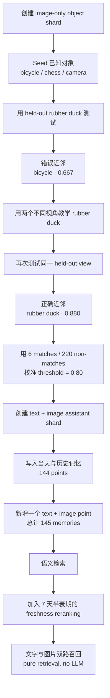
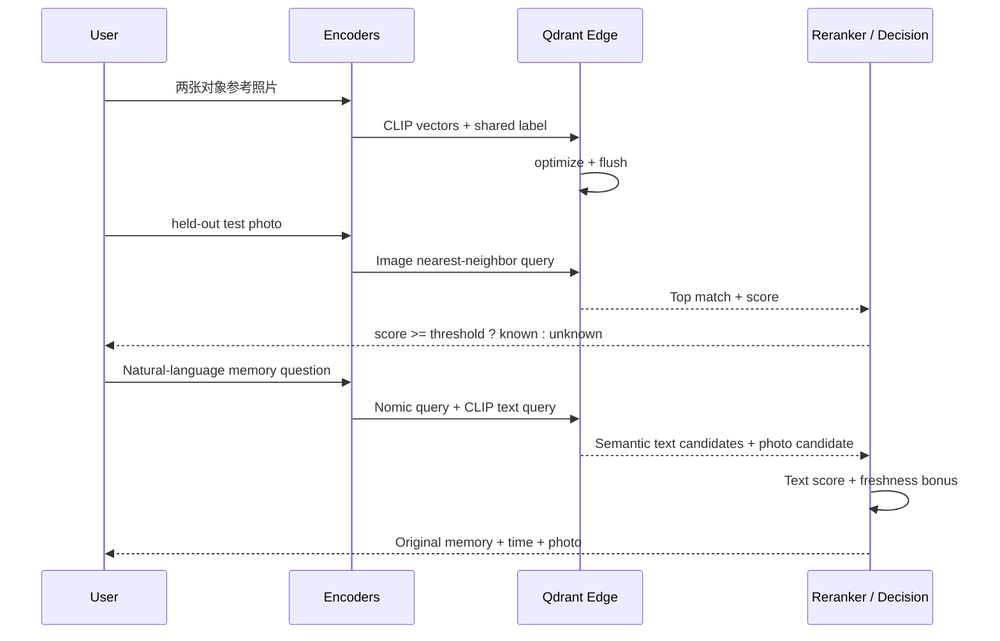

# 06. Learning Through Memory：用记忆教会助手识别新对象

> 课程：Building AI Assistants with On-Device Memory  
> 本课定位：第三节动手实验——少样本对象识别、阈值校准与基于时间的新鲜度重排  
> 前置笔记：[05 Building the Voice Assistant](05-building-the-voice-assistant.md)  
> 主要材料：[06 transcript](../transcripts/06-learning-through-memory.md) · [L5 notebook](../code/L5/Lesson5.ipynb) · [`helper.py`](../code/L5/helper.py)

## 1. 编号说明与学习目标

课程下载材料继续使用两套编号：

- transcript 把 Introduction 计为 01，因此本节是 `06-learning-through-memory.md`；
- notebook 按核心课程单元编号，因此配套实验位于 `L5/Lesson5.ipynb`。

前两节实验已经完成了文本、语音和照片的本地存储与召回。本课在此基础上解决两个更接近真实助手的问题：

1. **如何教会助手认识一个预训练模型没有专门标签的新对象？**
2. **当新旧记忆都语义相关时，如何优先返回较新的记忆？**

课程最终完成以下流程：

```text
测试未知对象 → 用少量照片教学 → 再次识别 → 校准阈值
→ 构建完整多模态记忆 → 加入时间衰减 → 执行端到端召回
```

本课有一个贯穿始终的核心思想：

> 助手的“学习”可以发生在外部记忆中，不一定要修改模型权重。

## 2. 本课实验全景



这张图包含两种不同的检索任务：

- **Image-to-image recognition：** 用测试照片寻找最相似的已教学照片；
- **Text-to-memory recall：** 用自然语言分别搜索文本记忆和照片记忆。

二者都依赖向量近邻，但输入、向量空间、判断方式和产品含义不同。

## 3. 先澄清：这里的“Learning”不是训练模型

课程使用 CLIP 生成图像 embedding，并把少量参考照片保存成带标签的 points。测试时再把新照片编码为 embedding，寻找最近的参考照片。

整个过程没有：

- fine-tune CLIP；
- 更新任何神经网络权重；
- 训练新的分类层；
- 调用云端视觉模型；
- 要求模型原本就知道用户给出的对象名称。

所谓 `teach("rubber duck", photos)`，实际完成的是：

```text
参考照片 → CLIP vectors → 写入 vector store
对象名称 → payload label
```

因此这更准确地说是一种 **exemplar-based recognition（基于样例的识别）** 或 **memory-based learning（基于记忆的学习）**。

它特别适合以下场景：

- “我的水杯”“我的背包”这类具体实例；
- 用户随时新教给设备的私人对象；
- 数据量很小，不值得重新训练模型；
- 需要完全离线、立即生效的端侧应用。

## 4. Step 1：创建只保存对象照片的 shard

```python
from helper import *
from qdrant_edge import EdgeShard, Point, UpdateOperation

object_shard = new_shard("./object_shard", image=512)
```

保存输出：

```text
Memory bank ready: image 512-d (CLIP)
```

这个 shard 只需要一个 512 维 `image` named vector，因为本阶段只做 photo-to-photo recognition。每张教学照片都会由 CLIP vision encoder 编码，然后单独成为一个 point。

## 5. Step 2：抽象 `add_memory` 与 `teach`

### 5.1 写入一条任意记忆

```python
def add_memory(shard, memory_id, vectors, payload):
    memory = Point(
        id=memory_id,
        vector=vectors,
        payload=payload,
    )
    shard.update(UpdateOperation.upsert_points([memory]))
```

`add_memory` 不关心 vector 是文本、图像还是二者兼有。调用者通过 `vectors` 与 `payload` 决定 point 的能力。

### 5.2 用多个视角教学一个对象

```python
def teach(shard, subject, view_paths, start_id):
    image_vectors = embed_image(view_paths)
    for i, (path, vector) in enumerate(
        zip(view_paths, image_vectors)
    ):
        add_memory(
            shard,
            memory_id=start_id + i,
            vectors={"image": vector},
            payload={"label": subject, "file": path},
        )
    shard.optimize()
    shard.flush()
```

如果用两张 rubber duck 照片教学，就会写入两个独立 points：

```text
id 100 → image vector of view 1 → label "rubber duck"
id 101 → image vector of view 2 → label "rubber duck"
```

同一 subject 的多个 views 不会先被平均成一个 vector。检索时，新照片只要接近其中一个已保存视角，就有机会得到正确标签。

### 5.3 为什么使用多个视角？

同一物体在不同条件下的像素变化可能很大：

- 正面与侧面；
- 室内与室外；
- 明暗变化；
- 背景、距离与遮挡变化。

多个参考视角在 vector space 中为同一个对象提供多个“锚点”，通常比只保存一张照片更稳健。

`optimize()` 为搜索整理索引，`flush()` 把更改持久化到磁盘。这使教学结果不只存在于当前 Python 对象的内存中。

## 6. Step 3：先保存三个已知对象

```python
seed_objects(object_shard)
```

课程先写入三条无关的图像记忆：

| ID | Label | Image |
| ---: | --- | --- |
| 0 | `a bicycle` | `bicycle.jpg` |
| 1 | `chess pieces` | `chess_set.jpg` |
| 2 | `a camera` | `camera.jpg` |

这样在教学 rubber duck 之前，shard 不是空的。测试未知物体时，可以清楚观察 nearest-neighbor retrieval 的一个基本性质：

> 只要数据库非空，top-1 搜索通常就会返回“最接近的一个”，即使所有候选其实都不正确。

## 7. Step 4：严格分开教学照片与测试照片

课程默认对象是 rubber duck：

```text
rubberduck_1.jpg → teach
rubberduck_2.jpg → teach
rubberduck_3.jpg → held out, test only
```

这里不能拿教学时使用过的同一张照片进行测试。否则只证明系统能找回几乎相同的输入，不能证明它能识别一个未见视角。

课程对象目录包含六个 subject：

| Subject | 照片数 | 教学视角 | Held-out 视角 |
| --- | ---: | ---: | ---: |
| backpack | 2 | 1 | 1 |
| gaillardia | 3 | 2 | 1 |
| hardhat | 3 | 2 | 1 |
| lithops | 2 | 1 | 1 |
| rubberduck | 3 | 2 | 1 |
| vase | 3 | 2 | 1 |

每组按文件顺序把最后一张保留为 held-out test，其余照片作为 taught views。

### 7.1 可选的自定义上传

notebook 提供两个上传区域：

- `Teach with these`：同一对象至少两张照片；
- `Test with this one`：同一对象恰好一张未参与教学的照片。

如果没有上传，`object_photos` 自动使用课程的 rubber duck。若只上传一张教学图或多张测试图，则辅助函数会抛出 `ValueError`，而不是悄悄接受不完整实验。

上传文件位于 notebook 的 `my_photos/teach` 与 `my_photos/test`。辅助代码在每个新 kernel 首次使用 uploader 时清理上一次 session 的上传文件，但同一 kernel 内重复显示 uploader 不会删除刚上传的照片。

## 8. Step 5：教学前测试——最近不等于正确

`recognize` 只做一次 image nearest-neighbor query：

```python
def recognize(shard, photo):
    top_match = shard.query(
        QueryRequest(
            query=Query.Nearest(
                embed_image([photo])[0],
                using="image",
            ),
            limit=1,
            with_payload=True,
        )
    )[0]
    return top_match
```

教学前把 held-out rubber duck 照片展示给助手，保存输出为：

```text
Closest memory: a bicycle
similarity: 0.667
```

系统并不是认为鸭子“在现实中就是自行车”。它只知道当前候选集合里 bicycle、chess pieces 与 camera 三者中，bicycle 的 CLIP vector 最近。

这说明必须区分两个问题：

```text
Retrieval：数据库里谁最接近？
Recognition：这个最近邻是否足够接近，可以被认为是同一对象？
```

最近邻搜索回答第一个问题；阈值决策才回答第二个问题。

## 9. Step 6：教学两个 rubber duck 视角

```python
SUBJECT = "rubber duck"
teach_photos = object_photos("teach")

teach(
    object_shard,
    SUBJECT,
    teach_photos,
    start_id=100,
)
```

保存输出：

```text
📷 Taught "rubber duck" from 2 photos
```

`SUBJECT` 只作为 metadata label 保存。CLIP 并没有因为字符串 `rubber duck` 而得到训练；真正用于 image-to-image similarity 的是两张照片的 vectors。

`start_id=100` 是课程为了避开 seed IDs 0–2 采用的简单约定。生产系统应使用稳定的唯一 ID 方案，避免后续教学覆盖已有 point。

## 10. Step 7：再次测试同一个 held-out view

```python
top_match = recognize(object_shard, test_photo)
recognition_result(test_photo, top_match)
```

保存输出变为：

```text
Closest memory: rubber duck
similarity: 0.880
```

对比教学前后：

| 状态 | Top label | Score | 是否正确 |
| --- | --- | ---: | --- |
| Before teaching | a bicycle | 0.667 | 否 |
| After teaching | rubber duck | 0.880 | 是 |

测试照片从未写入 shard。系统匹配到的是两张已教学图片之一，因此这次结果展示了对新视角的泛化，而不是完全相同图片的查重。

不过，0.880 是否足够高仍需要一个经过数据校准的标准。

## 11. Step 8：为识别选择 threshold

### 11.1 为什么不能只相信 top-1？

只要 shard 中存在 point，`recognize` 就会返回一个 top match。即使输入是完全未知的物体，仍会有“最不差”的候选。

因此需要将 retrieval score 转成产品决策：

```python
is_known = top_match.score >= THRESHOLD
```

本课设置：

```python
THRESHOLD = 0.80
```

rubber duck 的结果为：

```text
✅ rubber duck · similarity 0.880
0.880 clears the 0.800 threshold.
```

### 11.2 课程的 6 个 matches 如何产生？

对象目录有 6 个 subjects。每个 subject 保留最后一个视角作为 test，然后把它与本 subject 的 taught views 比较，取最高 similarity：

```text
每个 subject 产生 1 个 held-out positive
6 subjects × 1 = 6 matches
```

课程实验中最低的 true-match score 约为 **0.86**。

### 11.3 课程的 220 个 non-matches 如何产生？

六组对象一共有 10 张 taught views：

```text
backpack 1 + gaillardia 2 + hardhat 2
+ lithops 1 + rubberduck 2 + vase 2 = 10
```

负例来自两部分。

第一部分：每个 held-out object 与其他 subject 的 taught views 比较：

```text
6 × 10 - 10 个同 subject comparisons = 50
```

第二部分：17 张日常 scene photos 与全部 10 张 taught views 比较：

```text
17 × 10 = 170
```

因此：

```text
50 + 170 = 220 non-matches
```

课程实验中最高的 non-match score 约为 **0.74**。

### 11.4 为什么选择 0.80？

实验结果形成一个明显间隔：

```text
highest non-match ≈ 0.74
selected threshold = 0.80
lowest true match ≈ 0.86
```

0.80 位于两组边界中间，对这批数据可以同时拒绝已测试的 non-matches，并接受已测试的 matches。

但它不是 CLIP 的普适常数。更换以下任一条件都应重新校准：

- 摄像头、距离、光线与背景；
- 要识别的对象类型与相似程度；
- 教学照片数量和角度；
- embedding model 或模型版本；
- false positive 与 false negative 的业务成本。

### 11.5 False positive 与 false negative

| Threshold 选择 | False positive | False negative | 典型适用倾向 |
| --- | --- | --- | --- |
| 较低 | 增加 | 减少 | 宁可多认，也不想漏掉 |
| 较高 | 减少 | 增加 | 错认代价很高 |

例如，帮用户回忆普通玩具时可以容忍“可能是”；若识别结果要触发门锁或医疗操作，则应显著提高验证要求，不能只依赖本课的单一相似度阈值。

## 12. Qdrant Edge 的 shard handle 注意事项

notebook 特别提醒：这个端侧引擎在一个进程中一次只保持一个有效的 open shard handle。打开第二个 shard 后，先前 handle 可能失效，再使用会得到：

```text
Shard is not initialized
```

如果数据已经 flush 到磁盘，正确恢复方式是：

```python
object_shard.close()
object_shard = EdgeShard.load("./object_shard")
```

不要用下面的方式“修复”：

```python
new_shard("./object_shard", image=512)
```

因为 `new_shard` 内部调用 `fresh_start`，会删除原目录并创建空 shard，之前 seed 和 teach 的对象记忆都会消失。

## 13. Step 9：构建完整的 assistant memory

完成对象识别后，课程新建一个同时拥有 text 与 image spaces 的 shard：

```python
ASSISTANT_DIR = "./assistant_shard"
assistant_shard = new_shard(
    ASSISTANT_DIR,
    text=768,
    image=512,
)
```

```text
Memory bank ready: text 768-d (Nomic), image 512-d (CLIP)
```

然后加载当天和历史记忆：

```python
day, notes, photos = load_day_and_history()
store_day(assistant_shard, notes, photos)
```

`load_day_and_history` 的选择规则为：

```python
notes = [
    m for m in day + history
    if m["source_type"] in ("text", "voice")
]
photos = [
    m for m in day
    if m["source_type"] == "photo"
]
```

写入数量可以逐项还原：

| 来源 | Text | Voice | Photo | 写入数 |
| --- | ---: | ---: | ---: | ---: |
| 当天 `memories.json` | 20 | 5 | 17 | 42 |
| 历史 `recent_days.json` | 81 | 21 | 0 | 102 |
| Notes 合计 | 101 | 26 | — | 127 |
| 当天 photos | — | — | 17 | 17 |

因此 notebook 输出：

```text
Stored 127 notes
Stored 17 photos · 144 memories
```

历史文件只包含 text 和 voice records；本课只把当天的 17 张照片写入 assistant shard。

## 14. Step 10：创建一条真正的 multimodal point

课程把刚教学的 rubber duck 加入完整助手：

```python
MY_NOTE = (
    "Rubber duck for the bath, "
    "from the toy shop on Elm Street"
)

photo_vector = embed_image([teach_photos[0]])[0]
note_vector = embed_text([MY_NOTE])[0]

add_memory(
    assistant_shard,
    memory_id=5000,
    vectors={
        "image": photo_vector,
        "text": note_vector,
    },
    payload={
        "label": SUBJECT,
        "file": teach_photos[0],
        "note": MY_NOTE,
    },
)

save_shard(assistant_shard)
```

这是课程中一个非常重要的结构变化。前一课的 points 通常只含一个 vector：

```text
text/voice point → {"text": ...}
photo point      → {"image": ...}
```

这里同一个 point 同时含有：

```text
Point 5000
├── text vector：描述购买地点与用途
├── image vector：rubber duck 的视觉表示
└── payload：label + file + note
```

它因此可以由文字搜索找到，也可以由图像或 CLIP text-to-image search 找到，而且两条路线最终指向同一个 memory ID。

保存后的 receipt 为：

```text
Assistant memory ready
taught: rubber duck: photo + note
total: 145 memories
```

总数为：

```text
127 notes + 17 photos + 1 new multimodal point = 145
```

## 15. Step 11：为什么纯语义搜索会返回旧密码？

课程提出问题：

```python
question = "what is my gym locker code?"
```

只按 Nomic semantic similarity 检索时，结果为：

| Rank | Semantic score | Date | Memory |
| ---: | ---: | --- | --- |
| 1 | **0.798** | Aug 30 | Quick memo, locker code at the gym is 2280 |
| 2 | **0.784** | Sep 14 | Renewed the gym membership, locker code is 4471 |
| 3 | 0.596 | Sep 08 | Gym session, cardio and weights |

旧密码 2280 与问题的措辞更加直接，因此语义分数略高。但用户真正需要的通常是最新有效密码 4471。

Embedding model 并不知道：

- 哪个密码已经失效；
- “最新”在当前产品中很重要；
- timestamp 应如何参与排名。

向量 similarity 只表达语义接近程度，不会自动推断业务上的时间有效性。

## 16. Step 12：Soft Forgetting 与 freshness score

课程设置：

```python
LATEST_TIME = max(m["timestamp"] for m in day)
HALF_LIFE = 7 * 24 * 60 * 60
FRESHNESS_WEIGHT = 0.2

ranking = freshness_ranking(
    LATEST_TIME,
    HALF_LIFE,
    FRESHNESS_WEIGHT,
)
```

### 16.1 指数衰减

辅助函数使用 Qdrant Edge 的 exponential decay：

```python
freshness = Expression.Decay(
    DecayKind.Exp,
    Expression.Variable("timestamp"),
    target=Expression.Constant(LATEST_TIME),
    midpoint=0.5,
    scale=HALF_LIFE,
)
```

在本课参数下，可以把新鲜度理解为：

```math
freshness(age) = 0.5^{age / 7\text{ days}}
```

| 记忆年龄 | Freshness |
| ---: | ---: |
| 0 天 | 1.00 |
| 7 天 | 0.50 |
| 14 天 | 0.25 |
| 21 天 | 0.125 |

它会逐渐接近 0，但不会在某个日期突然把记忆删除。

### 16.2 最终重排公式

```math
final\_score = semantic\_score + 0.2 \times freshness
```

因此 freshness 最多增加 0.2：

- 最新记忆最多获得完整的 `+0.2`；
- 7 天前最多获得 `+0.1`；
- 14 天前最多获得 `+0.05`。

这种机制叫 **soft forgetting**：旧记忆仍存在，也仍能被检索，只是随时间推移得到的 ranking bonus 变小。

### 16.3 没有 timestamp 的记忆如何处理？

公式设置：

```python
defaults={"timestamp": LATEST_TIME}
```

缺少 timestamp 的 point 会被当作“当前最新”，而不是被丢弃或按 0 处理。课程新建的 rubber-duck memory 没有 timestamp，因此能获得最大 freshness bonus。

这是一个必须显式理解的默认值。真实系统更稳妥的做法通常是在创建记忆时写入可靠 timestamp，而不是长期依赖 fallback。

## 17. Step 13：两阶段检索与重排

`recent_text_search` 不是对全部记忆逐条执行公式：

```python
def recent_text_search(shard, question, ranking, limit=3):
    return shard.query(
        QueryRequest(
            limit=limit,
            prefetches=[
                Prefetch(
                    limit=20,
                    query=Query.Nearest(
                        embed_query(question),
                        using="text",
                    ),
                )
            ],
            query=ranking,
            with_payload=True,
        )
    )
```

数据流是：

```text
问题 → semantic embedding
→ 预取最相关的 20 个 candidates
→ 对这 20 个 candidates 应用 freshness formula
→ 返回最终 top 3
```

这保证时间不会让完全无关、但非常新的记忆轻易进入结果。但它也意味着：如果某条记忆没有进入 semantic top 20，freshness 无法把它“救回来”。

重排后的 locker-code 结果为：

| Rank | Meaning + freshness | Date | Memory |
| ---: | ---: | --- | --- |
| 1 | **0.972** | Sep 14 | Locker code is 4471 |
| 2 | **0.843** | Aug 30 | Locker code is 2280 |
| 3 | 0.706 | Sep 08 | Gym session, cardio and weights |

新密码从第二名升到第一名，而且与旧密码拉开明显差距。

### 17.1 Soft forgetting、过滤与删除

| 方法 | 数据是否仍在 | 作用 |
| --- | --- | --- |
| Freshness / soft forgetting | 是 | 逐渐降低旧记忆的排序优势 |
| Metadata filter | 是 | 当前查询只允许满足条件的候选 |
| Delete / hard forgetting | 否 | 从 shard 移除 point |

如果用户明确要求“忘掉旧密码”，应删除旧 point；如果只是希望默认优先当前信息，freshness reranking 更合适。

## 18. Step 14：关闭、重载并验证持久化

在最终提问前，notebook 显式关闭并从磁盘加载 shard：

```python
assistant_shard.close()
assistant_shard = EdgeShard.load(ASSISTANT_DIR)
```

这不是完成检索的必要算法步骤，而是一个持久化验证：前面写入并 flush 的 145 条记忆不依赖原 Python handle，重新打开后仍可以查询。

## 19. Step 15：端到端询问助手

课程对每个问题执行两条路线：

```python
words = recent_text_search(
    assistant_shard,
    question,
    ranking,
    limit=1,
)[0]

picture = photo_search(
    assistant_shard,
    question,
    limit=1,
)[0]
```

`words` 使用 Nomic semantic retrieval 加 freshness reranking；`picture` 使用 CLIP text-to-image retrieval。二者并不保证来自同一个 point。

### 19.1 `what did I get at the toy shop?`

| Result | Score | 内容 |
| --- | ---: | --- |
| Words | **0.859** | Rubber duck for the bath, from the toy shop on Elm Street |
| Photo | **0.238** | 教学时保存的 rubber-duck photo |

UI 标记 `✅ same memory`，因为 text 与 photo 两路都命中刚创建的 id 5000 multimodal point。时间栏显示 `you taught this`，因为它是用户教学的对象记忆，而不是历史日程记录。

### 19.2 `show me the bakery`

| Result | Score | 内容 |
| --- | ---: | --- |
| Words | **0.847** | New bakery on the corner does an amazing morning cronut |
| Photo | **0.253** | 最相关的 bakery photo |
| When | — | Sep 14 |

### 19.3 `where did I have brunch`

| Result | Score | 内容 |
| --- | ---: | --- |
| Words | **0.777** | Brunch at the cafe, pancakes and coffee, $14 |
| Photo | **0.222** | CLIP 返回的最相关照片 |
| When | — | Sep 08 |

### 19.4 `what did the bike chain cost`

| Result | Score | 内容 |
| --- | ---: | --- |
| Words | **0.969** | Bought new bike chain, $32 at station shop |
| Photo | **0.249** | 最相关的 bicycle photo |
| When | — | Sep 12 |

这四个答案全部来自已存储内容的 retrieval。没有 LLM 阅读结果后重新措辞，也没有生成数据库中不存在的答案。

特别是价格 `$32`，来自 text payload 的原始记忆，而不是模型根据自行车照片猜出的价格。

## 20. 本课完整数据流



对象识别路径与日常回忆路径共享本地 vector store，却使用不同的后处理：

- Recognition 需要 `similarity >= threshold`；
- Text recall 需要 semantic candidates 加 freshness formula；
- Photo recall 仍通过 CLIP text-to-image nearest search 完成。

## 21. 与机器人实时识别的关系

transcript 最后指出，课程开头展示的机器人使用相同思想，只是把单张测试图片换成连续视频帧：

```text
Camera frame
→ object detection / crop
→ CLIP embedding
→ nearest taught memory
→ threshold decision
→ repeat for next frame
```

本 notebook 证明的是单次 teach/recognize/recall 的核心逻辑。真实实时系统还要处理：

- 摄像头帧率与推理延迟；
- 同一对象连续多帧造成的重复记忆；
- object tracking 与去抖动；
- 不同距离、遮挡和光线下的 threshold；
- 何时记录“最后看见该对象”；
- 内存、功耗与 shard 持久化策略。

下一课会把完整循环运行在个人电脑上。

## 22. 运行 notebook 时的常见问题

### 问题 1：教学前总会返回一个错误对象

这是 nearest-neighbor search 的预期行为。数据库只回答“谁最近”，不会自动回答“是否足够近”。需要 threshold 才能输出 unknown。

### 问题 2：测试得分异常高

检查是否误把 test photo 放入 teach folder。训练/教学与 held-out 测试必须使用不同照片，否则会产生数据泄漏。

### 问题 3：只上传了一张教学照片

自定义流程要求至少两张教学图。上传两张以上同一具体对象、不同角度或环境的照片；如果想使用默认示例，应让上传目录保持为空。

### 问题 4：重启 kernel 后上传图片消失

辅助代码会在新 kernel 首次使用 uploader 时清理上一次 session 的 `my_photos`。需要重新上传，或者直接使用 bundled rubber duck。

### 问题 5：`Shard is not initialized`

另一个 shard 被打开后，旧 handle 可能失效。关闭旧 handle，再用 `EdgeShard.load(path)` 从磁盘恢复；不要调用会清空目录的 `new_shard`。

### 问题 6：新增对象覆盖了旧对象

`upsert` 遇到相同 ID 会更新对应 point。`start_id=100` 和 `memory_id=5000` 只是教学约定，实际应用需要可靠的 ID 分配。

### 问题 7：最新记忆仍未进入结果

检查：

- timestamp 是否存在且单位一致；
- `LATEST_TIME` 是否与数据处于同一时间尺度；
- 记忆是否进入 semantic prefetch top 20；
- `FRESHNESS_WEIGHT` 是否足以改变接近候选的排序；
- 查询是否使用 `recent_text_search` 而不是普通 `text_search`。

### 问题 8：没有 timestamp 的旧数据被当成最新

这是课程公式的明确 fallback：缺失值默认等于 `LATEST_TIME`。生产系统应补齐 capture time，或为缺失时间设计更保守的默认策略。

### 问题 9：照片结果与文字结果不是同一件事

这是允许的。两条检索使用不同模型与候选空间；只有同一个 point 同时保存 text/image vectors 且两路都命中时，才是 `same memory`。

### 问题 10：0.80 在自己的摄像头上误判严重

课程 threshold 来自特定数据分布。收集自己设备、对象和环境下的 held-out positives 与 realistic negatives，重新画分布并选择阈值。

## 23. 建议动手修改

1. 使用 vase 或 hardhat 的前两个视角教学，最后一个视角测试，记录 before/after score。
2. 只使用一个教学视角，再使用两个教学视角，比较 held-out recognition 的稳定性。
3. 故意用完全不同的物体测试，验证 top-1 仍返回候选，但 threshold 应拒绝它。
4. 分别尝试 0.75、0.80、0.85 阈值，列出 false positive 与 false negative 的变化。
5. 为 rubber-duck multimodal point 增加 timestamp，比较它与默认 current fallback 的 final score。
6. 把 `HALF_LIFE` 改为 1 天、7 天和 30 天，预测 locker-code 排名后再运行。
7. 把 `FRESHNESS_WEIGHT` 改为 0、0.1、0.5，观察 recency 何时开始压过明显的语义差异。
8. 将 semantic prefetch 从 20 改小，寻找一条因未进入 candidates 而无法被 freshness 提升的记忆。
9. 为同一个 point 同时写入 text/image vectors，再验证两个 query lanes 是否返回相同 ID。
10. 关闭并重新加载 shard，确认教学对象和新增记忆仍然存在。

## 24. 术语速查

| 术语 | 本实验中的含义 |
| --- | --- |
| Exemplar | 用于代表某个具体对象的参考照片 |
| Few-shot teaching | 用少量示例建立可检索对象记忆 |
| Held-out view | 完全不参与教学、专门用于测试的新视角 |
| Image-to-image retrieval | 用测试图片 vector 搜索已保存图片 vectors |
| Recognition threshold | 把 top similarity 转换为 known/unknown 决策的界线 |
| True match | held-out view 与同一对象教学照片的匹配 |
| Non-match | 不同对象或场景图与教学照片的匹配 |
| False positive | 未知或不同对象被错误接受为已知对象 |
| False negative | 同一对象的新视角被错误拒绝为 unknown |
| Multimodal point | 同一个 point 同时保存 text 与 image named vectors |
| Freshness | 根据 timestamp 计算的 0–1 时间新鲜度 |
| Half-life | freshness 衰减到一半所需的时间 |
| Soft forgetting | 不删除旧记忆，只降低其排序优势 |
| Prefetch | 先按向量相似度取得候选，再进行公式重排 |
| Pure retrieval | 直接返回已存记忆，不通过 LLM 生成答案 |

## 25. 本课小结

- 助手可以通过保存少量参考照片认识新的具体对象，无需 fine-tuning CLIP。
- 多个教学视角以独立 points 保存，并共享同一个 payload label。
- Held-out test photo 必须与教学照片分离，才能检验对新视角的泛化。
- 教学前 rubber duck 的最近邻是 bicycle，score 0.667；教学后正确匹配 rubber duck，score 0.880。
- Nearest-neighbor retrieval 总会返回候选，recognition 必须另外设置 threshold。
- 课程用 6 个 held-out matches 和 220 个 non-matches 观察 score distributions，并为当前数据选择 0.80。
- 课程 threshold 只适用于当前实验条件；真实系统应根据 false-positive/false-negative 成本重新校准。
- 完整 assistant shard 先保存 127 条 notes 和 17 张照片，再加入 1 条 rubber-duck multimodal point，共 145 条记忆。
- 同一个 point 可以同时包含 Nomic text vector 与 CLIP image vector，因此能从文字与视觉两条路线找到。
- 纯语义检索把旧 locker code 2280 排在新密码 4471 前；加入 freshness 后新密码以 0.972 升至第一。
- Freshness 使用 7 天半衰期，最终分数是 semantic score 加最多 0.2 的时间 bonus。
- `recent_text_search` 只重排 semantic prefetch 的 20 个 candidates，新鲜度不会让完全不相关的内容无限上升。
- Soft forgetting 保留旧记忆但降低排序优势；它不同于 filter，也不同于真正删除 point。
- 最终四个问答全部来自本地向量检索，没有 LLM 参与答案生成。

## 26. 复习问题

1. 本课的“teach”为什么不等于训练或 fine-tune CLIP？
2. 为什么同一对象要保存多个不同视角？
3. 为什么 test photo 不能与 teach photos 重复？
4. 教学前 rubber duck 为什么仍会返回 bicycle？
5. Retrieval 与 Recognition 的区别是什么？
6. 6 个 true matches 与 220 个 non-matches 分别是如何构造的？
7. 为什么 0.80 不能直接成为所有设备和对象的固定阈值？
8. 降低 recognition threshold 会怎样影响 false positives 与 false negatives？
9. 一条 point 如何同时被 text search 与 image search 找到？
10. 最终 145 条记忆由哪些数据组成？
11. 纯语义搜索为什么更偏好旧 locker code 2280？
12. 7 天 half-life 具体意味着什么？
13. `FRESHNESS_WEIGHT=0.2` 对最终分数施加了什么上限？
14. 为什么没有 timestamp 的 point 会被当成最新记忆？
15. Prefetch 为什么既能提高重排效率，也会限制 freshness 的作用范围？
16. Soft forgetting 与 hard delete 有什么根本区别？
17. 为什么最终 words 与 photo 不一定属于同一个 memory？
18. 把单次 recognition 用于视频帧循环时，还需要解决哪些工程问题？

## 下一课

下一节会把同样的助手代码运行在个人电脑上，接入摄像头和麦克风，并演示教学、持续识别、回忆、重命名与遗忘对象：

- 视频 transcript：[07 Running on a Local Computer](../transcripts/07-running-on-a-local-computer.md)

## 资料来源

- [06：Learning Through Memory transcript](../transcripts/06-learning-through-memory.md)
- [L5：Learning Through Memory notebook](../code/L5/Lesson5.ipynb)
- [L5 课程辅助函数](../code/L5/helper.py)
- [当天综合记忆数据](../code/L5/ro_shared_data/memories.json)
- [历史记忆数据](../code/L5/ro_shared_data/recent_days.json)
- [对象照片说明](../code/L5/ro_shared_data/objects/README.md)
- [对象照片目录](../code/L5/ro_shared_data/objects/)
- [当天场景照片目录](../code/L5/ro_shared_data/images/)
- [课程运行说明](../code/README.md)
- [课程固定依赖](../code/requirements.txt)
