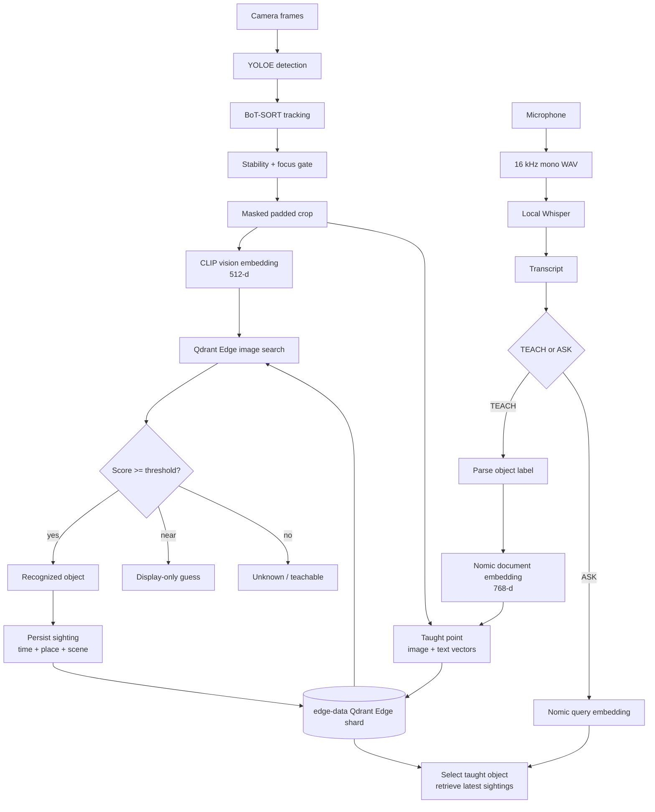
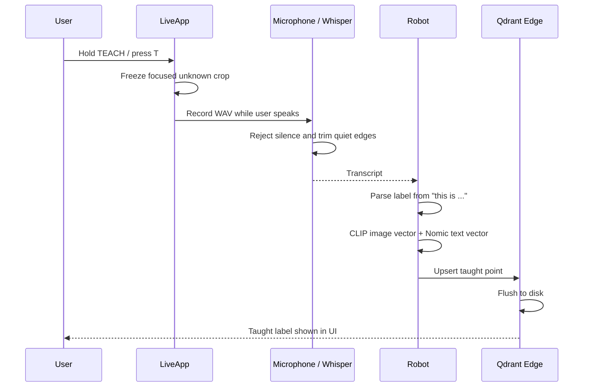
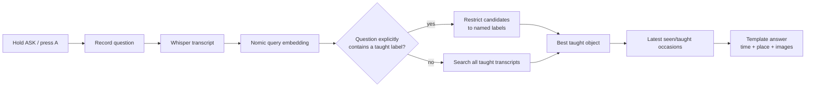

# 07. Running on a Local Computer：在个人电脑上运行完整的实时记忆助手

> 课程：Building AI Assistants with On-Device Memory  
> 本课定位：把 notebook 中的本地记忆原型接入摄像头、麦克风、实时检测和浏览器界面  
> 前置笔记：[06 Learning Through Memory](06-learning-through-memory.md)  
> 主要材料：[07 transcript](../transcripts/07-running-on-a-local-computer.md) · [课程官方应用仓库](https://github.com/https-deeplearning-ai/sc-on-device-ai-memory)  
> 源码核对版本：官方仓库 `main`，commit [`e40c3579`](https://github.com/https-deeplearning-ai/sc-on-device-ai-memory/tree/e40c35795ed93b9afcbaa80f70c0aec3b8a77b5a)

## 1. 本课定位

前面三节 notebook 分别建立了：

- Qdrant Edge 本地向量记忆；
- 文本、语音和照片的统一召回；
- 从少量照片教学新对象；
- recognition threshold 与 freshness reranking。

本课不再引入一个新的 notebook，而是运行课程配套的完整开源应用。它在 notebook 的记忆层之外加入：

- 摄像头视频流；
- YOLOE object detection；
- BoT-SORT object tracking；
- 麦克风录音与本地 Whisper；
- 实时 object teaching 与 recognition；
- 浏览器/手机界面；
- 对象 sightings、rename、forget 和 ignore；
- 磁盘持久化与设备重启恢复。

课程视频展示的是“从实验代码到持续运行产品”的最后一步。

## 2. 完整应用的能力边界

这个应用可以：

1. 从摄像头画面中检测并追踪物体；
2. 让用户按住 **TEACH**，说出 `This is my controller`；
3. 把当前物体视角和语音描述保存为本地记忆；
4. 下次看见该物体时，用已教学照片识别它；
5. 保存物体出现的时间、地点和现场截图；
6. 回答 `Where did you last see my controller?`；
7. 在 MEMORY 页面查看、改名、删除或忽略记忆。

它仍然不依赖 LLM。答案由检索结果和固定模板生成，不会自由编写数据库中不存在的事实。

应用也不需要：

- Qdrant Server；
- Qdrant Cloud account；
- API key；
- NVIDIA Jetson；
- 3D 打印外壳。

普通个人电脑、摄像头和麦克风就能运行核心体验。

## 3. 运行前准备

官方 Get Started 列出的要求为：

| 项目 | 要求 |
| --- | --- |
| 操作系统 | 64-bit Windows x86、macOS 或 Linux |
| Python | 3.12 或更新版本 |
| 包管理器 | `uv` |
| 输入设备 | Webcam + microphone |
| 模型磁盘空间 | 约 1.5 GB |
| 浏览器 | 能访问本机地址即可 |

首次启动会下载四类本地模型组件：

- YOLOE detector；
- CLIP vision encoder；
- Nomic text encoder；
- Whisper speech model。

模型缓存完成后，检测、转写、embedding、vector search 和记忆管理都可以在设备本地完成。

## 4. 下载、安装与启动

### 4.1 Clone 官方仓库

```bash
git clone https://github.com/https-deeplearning-ai/sc-on-device-ai-memory.git
cd sc-on-device-ai-memory
```

也可以按照视频演示使用 GitHub Desktop 等图形化工具。

### 4.2 安装固定依赖

```bash
uv sync
```

`uv sync` 会：

- 创建隔离的 Python environment；
- 根据 `pyproject.toml` 与 `uv.lock` 安装课程验证过的版本；
- 安装 Qdrant Edge、FastEmbed、Whisper、OpenCV、Ultralytics、PyTorch 和音频依赖。

关键固定版本包括：

| Package | Version / constraint |
| --- | --- |
| `qdrant-edge-py` | 0.7.2 |
| `fastembed` | 0.8.0 |
| `onnx-asr` | 0.12.0 |
| `onnxruntime` | 1.27.0 |
| `numpy` | 2.5.1 |
| `torch` | 2.13.0 |
| `torchvision` | 0.28.0 |

Encoder 版本与 recognition scores 直接相关。更换模型或依赖后，不能继续盲用原来的阈值。

### 4.3 创建 `.env`

课程文档写的是：

```bash
cp .env.example .env
```

但本笔记核对的官方 commit `e40c3579` 中，真实文件名是 `env.example`，没有开头的点。因此当前仓库应使用：

```bash
cp env.example .env
```

Windows PowerShell 对应：

```powershell
Copy-Item env.example .env
```

如果未来仓库修正了文件名，应先检查根目录实际存在的是 `env.example` 还是 `.env.example`，再执行复制。不要机械照抄一个不存在的路径。

### 4.4 启动应用

```bash
uv run python -m robot.app
```

应用默认打开：

```text
http://127.0.0.1:8765
```

浏览器没有自动出现时，手动访问该地址即可。使用 `Ctrl-C` 结束程序。

## 5. 最小操作流程

1. 把一个物体放在摄像头中央，等待检测框稳定。
2. 按住 **TEACH** 或键盘 `T`。
3. 说完整短句，例如 `This is my mug`，然后松开。
4. 转动物体，从另外两三个角度重复教学。
5. 将物体移出画面，再重新展示。
6. 识别成功后，打开 **MEMORY** 查看教学视角和 sightings。
7. 按住 **ASK** 或键盘 `A`，询问 `When did you last see my mug?`。

官方文档建议说一个短句而不是孤立名词。完整句子给 Whisper 更多语音上下文，也给 Nomic text memory 留下更完整的检索内容。

## 6. 控制方式

| Control | 行为 |
| --- | --- |
| `T` / **TEACH** | 教学当前获得焦点的 unknown object |
| `A` / **ASK** | 通过语音询问某个已教学对象 |
| `M` / **MEMORY** | 查看和管理记忆 |
| `Q` / **IGNORE** | 忽略当前 unknown object |
| `F` | 删除当前识别对象的全部相关记忆 |
| `R` | 关闭并从磁盘重新加载 shard |
| `Ctrl-C` | 安全停止应用 |

`F` 是面向开发的键盘快捷方式。由于摄像头焦点可能在按键前发生移动，正式删除更适合在 MEMORY 页面中确认对象后执行。

## 7. 从摄像头到记忆的全景架构



## 8. 软件分层

官方架构有一条重要边界：

```text
robot/device 可以 import robot/brain
robot/brain 不 import robot/device
```

这样可以把核心记忆逻辑与摄像头、浏览器、线程和操作系统资源分离。

| 模块 | 职责 |
| --- | --- |
| `robot/brain/core.py` | 连接检测、识别、教学、询问和 sightings |
| `robot/brain/memory.py` | Qdrant schema、写入、检索、改名、遗忘 |
| `robot/brain/models.py` | 延迟加载 CLIP、Nomic、Whisper |
| `robot/brain/detect.py` | YOLOE、BoT-SORT、crop、稳定性与焦点 |
| `robot/device/live.py` | 摄像头主循环、workers、按键和语音动作 |
| `robot/device/server.py` | HTTP routes、MJPEG stream、浏览器 API |
| `robot/device/page.html` | 实时 UI 与 MEMORY 页面 |
| `robot/app.py` | CLI、实时启动和离线文件 replay |

## 9. 实时运行为什么需要多个工作线程？

如果检测、语音转写、数据库写入和画面渲染全部串行执行，任何一次较慢推理都会冻结视频界面。应用把工作分成四类：

| Job | 职责 |
| --- | --- |
| Main loop | 读取摄像头、画框、编码并发布 JPEG |
| Detection worker | YOLOE、crop embedding、memory query |
| Key worker | 按顺序处理按钮和键盘动作 |
| Voice worker | 录音、转写、teach 或 ask |

`LiveApp.lock` 保护 tracking 与 UI 共享状态，`Memory` 内部使用 `threading.RLock` 串行化 shard 操作。代码约定先取得 live-state lock，再取得 memory lock，避免不同线程采用相反顺序造成 deadlock。

## 10. Object detection 不负责命名

应用使用 YOLOE 找到：

- bounding box；
- segmentation mask；
- detection confidence；
- tracking ID。

但它会丢弃 detector 自己的 class label。画面中显示的 `my controller`、`dresser` 或 `hat` 都来自用户教学的 memory payload，而不是 YOLOE 的预训练分类结果。

这项设计把两件事分开：

```text
Detector：哪里有一个可以关注的物体？
Memory：这个具体物体对用户来说叫什么？
```

因此教学新名称不需要重新训练 detector。

## 11. Tracking、稳定性与查询节奏

实时视频中，同一个物体会连续出现很多帧。如果每帧都做 embedding、vector query 和写入，计算与存储会迅速膨胀。

应用设置：

```python
STABLE_FRAMES = 3
REQUERY_SECONDS = 2.0
DEAD_SECONDS = 5.0
```

含义是：

- track 至少连续稳定 3 个检测 pass 后才会显示并参与识别；
- 稳定 track 最多每 2 秒重新查询一次 memory；
- 检测器短暂漏检时保留 track state，最后出现 5 秒后才清理。

这抑制了一闪而过的误检测，也避免对同一静止物体每帧重复查询。

## 12. Recognition crop 如何降低背景干扰？

用于 embedding 的 crop 会：

1. 在 bounding box 外增加 12% margin；
2. 使用 segmentation mask 保留对象；
3. 将 mask 外的背景填成统一灰色；
4. 用处理后的 BGR crop 生成 CLIP vector。

```text
PAD = 0.12
FILL = (124, 124, 124)
```

课程视频中，hat 在 DeepLearning.AI 录影棚被教学，回到纽约办公室仍能识别。削弱背景信息有助于让 embedding 更关注物体本身，而不是记住录影棚的桌面或墙壁。

不过这不是完全的视觉不变性。距离、旋转、光线、遮挡和图像清晰度仍会改变 score，所以需要多个教学视角和摄像头校准。

## 13. Focus：为什么只有一个 unknown 可以被教学？

Detector 可能同时产生许多 unknown boxes。应用只选择一个最显著的 unknown 作为 `teachable`：

- 综合对象大小与画面中心位置形成 salience；
- 新对象必须明显比当前对象更突出才会抢走焦点；
- `FOCUS_MARGIN = 1.6` 用来减少焦点来回跳动；
- 已识别物体不会成为 TEACH target，避免意外改名。

界面中最粗的框表示当前 focus。按下 TEACH 时，应用会复制此刻的 crop、frame 和 box，而不是保留一个之后可能继续变化的对象引用。

## 14. 实时 recognition threshold

官方应用默认：

```text
RECOGNIZE_THRESHOLD = 0.90
MAYBE_MARGIN = 0.05
```

判断分为三段：

| Score | 行为 |
| --- | --- |
| `score >= 0.90` | 正式识别，显示 label，并允许产生 sighting |
| `0.85 <= score < 0.90` | 只显示橙色 guess，不算识别 |
| `score < 0.85` | unknown |

Near-match guess 可以让用户确认，但它不会创建 sighting，也不能当成可靠识别结果。

### 14.1 为什么上一课是 0.80，这里却是 0.90？

上一课的 0.80 来自静态课程图片的正负样本分布。实时摄像头画面中的无关 crop 往往共享：

- 相同传感器特征；
- 相同光线；
- 相似背景；
- 相似距离和 scale。

官方校准指南指出，无关图片也可能落在 0.75–0.85。实时应用因此使用更严格的默认值 0.90。

`0.90` 不是“90% confident”，只是当前 embedding/crop pipeline 下的 cosine-similarity cutoff。

## 15. 如何校准自己的摄像头？

```bash
uv run python testdata/verify_scores.py
```

这个脚本使用与实时机器人相同的 crop 逻辑，比较：

- 同一对象不同视角的 match scores；
- 不同对象的 non-match scores；
- 两组区间之间是否存在可用 gap；
- 多个候选 threshold 下的判断结果。

要使用自己的照片：

```bash
uv run python testdata/verify_scores.py --source ~/my-photos
```

文件应按对象命名，例如：

```text
mug_1.jpg
mug_2.jpg
mug_3.jpg
controller_1.jpg
controller_2.jpg
controller_3.jpg
```

如果 match 与 non-match 区间重叠，单一阈值无法同时避免误报和漏报。优先改善拍摄条件：靠近对象、增加光线、让对象填满更多画面或提供更多教学角度。

## 16. TEACH 的完整数据流



### 16.1 麦克风处理

电脑录音最长 8 秒，以设备默认采样率捕获，再转换成 16 kHz、mono、16-bit WAV。检测到语音后连续静音约 0.9 秒会提前结束录音。

辅助逻辑还会：

- 检查是否真的收到声音；
- 用 RMS floor 拒绝几乎无声的录音；
- 去掉首尾静音并保留约 0.2 秒 padding；
- 再交给本地 `whisper-base` 转写。

剪掉静音既减少推理时间，也降低 Whisper 在空白音频上产生 hallucination 的概率。

### 16.2 从完整句子提取 label

例如：

```text
This is my controller.
```

`parse_label` 会：

1. 找到 `this is` 后面的内容；
2. 可跳过 `a` / `an`；
3. 在新从句常见词或标点前停止；
4. 最多保留五个词；
5. 转为小写。

这样 `This is my mug, Maria made it` 会得到：

```text
my mug
```

统一小写很重要，因为 label 同时用于识别展示、查找、重命名、合并和删除。

### 16.3 一次教学写入什么？

`taught` point 同时拥有：

```text
image vector  → CLIP 512-d，用于识别
text vector   → Nomic 768-d，用于语音回忆
```

Payload 包含：

```text
kind = taught
label
transcript
ts
where
thumb
scene
```

再次教学同一个 label 会增加一个新 point，不会覆盖以前的视角。这正是课程建议转动物体、教学两三次的原因。

## 17. 从 notebook 到实时应用的一项关键变化

上一课 notebook 的端到端问题同时执行：

- Nomic 文字搜索；
- CLIP text-to-image 搜索。

实时应用没有加载 CLIP text tower。官方源码明确说明，实际测试中用问题文字搜索 image space 效果不佳，因此 ASK 改为：

```text
问题 transcript
→ Nomic query vector
→ 在 taught text vectors 中选择对象
→ 根据选中 label 查找最新 sightings
```

换句话说，实时应用先通过“你当初如何描述这个对象”理解问题，再回到该对象的视觉 sightings。

这体现了从课程原型到产品实现的正常迭代：保留有效概念，但根据真实测量调整检索路线。

## 18. ASK 与 recall 流程



如果问题中直接出现已教学名称，如 `Where is my hat?`，系统先识别 exact label words，再把 semantic candidates 限制到该对象。这避免另一个语义相似对象覆盖用户明确指定的名字。

匹配会忽略大小写，并对较长英文词尾的复数 `s` 做简单归一化。因此视频中 `hats` 与改名后的 `hat` 能更稳定地对应。

## 19. 答案不是由 LLM 生成

应用根据检索结果拼接固定句式：

```text
I saw <label> at <time>, in <where>.
Before that at <earlier time> and <earlier time>.
```

如果最新记录本身是教学事件，则使用：

```text
You showed me <label> at <time>.
```

其他分支包括：

- 今天没有看到对象：`I didn't see anything today.`
- 尚未教学任何对象：`You haven't taught me anything yet.`
- 认识对象但没有 sightings：`I know ..., but I haven't seen it around.`

macOS 上如果系统存在 `say` 命令，应用会朗读模板答案；其他设备仍会在浏览器 panel 中显示。这里的语音输出是操作系统 TTS，不是 LLM。

## 20. Memory schema：三种 point

一个 shard 同时定义：

| Named vector | Dimension | Model | Distance |
| --- | ---: | --- | --- |
| `text` | 768 | Nomic | Cosine |
| `image` | 512 | CLIP vision | Cosine |

所有 points 用 `kind` 区分生命周期角色：

| `kind` | Vectors | 用途 |
| --- | --- | --- |
| `taught` | `image` + `text` | 用户命名的对象参考视角 |
| `seen` | `image` | 后来再次看见已知对象的记录 |
| `ignored` | `image` | 用户明确忽略、以后继续隐藏的 clutter |

Shard 为 `kind` 与 `ts` 创建 payload indexes，支持按类型和时间读取。

运行时数据默认位于：

```text
edge-data/
├── Qdrant Edge shard data
├── thumbs/
│   ├── taught crops
│   └── scene images
└── where.txt
```

Embedding models 位于用户目录下持久的 FastEmbed cache，手机 HTTPS 使用的证书位于 `cert/`。

## 21. Sighting 是如何产生的？

当 stable track 正式匹配一个 taught object 后，应用写入一条 `seen` point：

```text
image vector + label + timestamp + location + scene thumbnail
```

但它不是每帧写一次。每个 Track 有 `sighted` flag：

```python
if recognized and not track.sighted:
    remember_sighting(...)
    track.sighted = True
```

因此 transcript 所说的“continuously updating”应理解为：

- 系统持续处理摄像头；
- 新出现或重新建立的 track 会新增 sighting；
- 同一个连续 track 不会以摄像头帧率重复写库。

此外，召回时会把相隔不足 600 秒的同 label sightings 合并为一次 occasion，避免回答中连续罗列同一时段的许多近似照片。

## 22. 为什么 hat 能从录影棚带到纽约办公室？

课程视频中，hat 在 DeepLearning.AI 录影棚教学，之后在纽约办公室仍能识别。所需条件是：

1. taught vectors 与 payload 已 flush 到本地 `edge-data/`；
2. 应用重新启动时 load 同一个 shard；
3. 新画面中的 crop 与某个 taught view 达到 threshold。

这不是云同步，也不是模型永久学会了所有 hat。记忆随着 shard 文件存在于设备上；换一台没有这些文件的电脑，不会自动继承该对象。

应用每次 `_upsert` 后都会 `flush()`，因为物理设备被直接断电是正常关机场景。键盘 `R` 还会关闭并重新加载 shard，演示数据确实来自磁盘而不是仅存于当前进程。

## 23. MEMORY 页面：从“看见”到“管理”

Memory Library 会按对象组织：

- label；
- 所有 taught views；
- 被看见的总次数；
- 每次 sighting 的时间、地点和照片；
- ignored objects。

### 23.1 Rename

视频中 `hats` 被修正成 `hat`。源码执行两部分更新：

1. 所有相关 taught 与 seen points 的 payload label 被修改；
2. taught points 的 text vectors 用新名称重新编码。

Image vectors 不改变，因为对象外观没有变化。若改成一个已存在的 label，两组 points 会在 UI 和 recall 中合并成一个对象。

### 23.2 Forget 整个对象

`forget(label)` 会 case-insensitively 找到该 label 的所有 points，并删除：

- 全部 taught views；
- 全部 seen sightings。

删除后画面中的 label 与 guess 也会清空并强制重新查询。由于不再存在 taught exemplar，hat 会重新显示成 unknown。

这正是课程中的显式遗忘：不是降低排序，也不是隐藏 UI，而是删除构成对象知识的记忆 points。

### 23.3 删除单个 view 或 sighting

用户可以只删除一个不好的教学角度，而不是忘记整个对象。但如果删除的是最后一个 taught view，应用会改为忘记整个对象。

删除一个 sighting 时，系统同时删除与它属于同一十分钟 occasion 的 burst，避免同一次出现留下许多近似记录。

### 23.4 Ignore 与 Forget 不同

`Q` / **IGNORE** 针对当前 unknown clutter：

1. 保存一条 `kind="ignored"` 的 image memory；
2. 隐藏当前 track；
3. 下次相似 crop 达到 recognition threshold 时继续隐藏；
4. 在 MEMORY 页面可以 unignore。

| 操作 | 对象原本是否已知 | 数据效果 |
| --- | --- | --- |
| Forget | 是 | 删除 label 的 taught 与 seen points |
| Ignore | 否 | 新增 ignored point，记住“不需要关注它” |
| Unignore | ignored | 删除对应 ignored point，恢复追踪机会 |

## 24. `.env` 配置详解

### 24.1 Recognition

```dotenv
RECOGNIZE_THRESHOLD=0.90
```

过低会使房间中的许多物体都匹配最近教学对象；过高会使同一对象稍微旋转或改变光线后变成 unknown。

### 24.2 Detection

```dotenv
DETECT_CONF=0.30
DETECT_MAX_AREA=0.20
DETECT_MIN_AREA=0.001
```

| Setting | 作用 |
| --- | --- |
| `DETECT_CONF` | Detector confidence floor；提高后减少 clutter |
| `DETECT_MAX_AREA` | 丢弃占画面比例过大的墙、桌面或整片区域 |
| `DETECT_MIN_AREA` | 丢弃远处太小、容易抢走焦点的目标 |

面积参数是画面面积比例。将最小面积加倍，并不意味着最小边长也加倍。

### 24.3 Camera

```dotenv
CAMERA_ROTATE=0
FRAME_CROP=0
```

`CAMERA_ROTATE` 只支持 0 或 180。机器人外壳中的摄像头倒装时用 180；普通电脑通常用 0。

必须在教学前确定旋转设置。CLIP 并不会完全忽略图像旋转，之后改变角度可能使现有 taught views 失效。

`FRAME_CROP` 可以是一个边缘比例，也可以是：

```text
left,top,right,bottom
```

它适合裁掉广角镜头的黑边。Crop 在 rotation 之后执行，因此方向与最终界面一致。

### 24.4 Microphone

默认使用系统 input device。选错设备时先列出：

```bash
uv run python -c "import sounddevice; print(sounddevice.query_devices())"
```

然后在 `.env` 中设置名称或 numeric index：

```dotenv
MIC_DEVICE=1
```

## 25. 配置优先级与 CLI flags

配置优先级为：

```text
source defaults
< .env
< exported environment variables
< command-line flags（存在对应 flag 时）
```

常用 flags：

| Flag | 作用 |
| --- | --- |
| `--camera 1` | 选择另一台摄像头 |
| `--threshold 0.90` | 当前运行临时覆盖 recognition threshold |
| `--conf 0.30` | 临时覆盖 detection confidence |
| `--max-area 0.20` | 临时覆盖最大检测面积 |
| `--location "Office"` | 给之后的新记忆写入地点 |
| `--source DIR` | 不使用摄像头，回放图片目录或视频 |
| `--data DIR` | 使用另一个 shard 目录 |
| `--host 0.0.0.0` | 允许局域网设备访问 UI |
| `--reset` | 启动前删除所选 shard |

> **危险操作：** `--reset` 会递归删除 `--data` 指向的整个记忆目录。只在确认不需要保留教学对象和 sightings 时使用。

测试破坏性改动时，优先指定一个独立目录：

```bash
uv run python -m robot.app --data edge-data-test --reset
```

## 26. 不连接摄像头的 smoke test

```bash
uv run python -m robot.app --source testdata/
```

这个模式用 bundled images 驱动：

- detection；
- crop；
- CLIP embedding；
- memory lookup。

空 shard 中所有图片显示 `UNKNOWN` 是正确结果。这个命令验证软件 pipeline 能运行，不是 recognition-accuracy test。

轻量单元测试不会加载大型模型：

```bash
uv run python -m unittest discover -s tests -t .
```

## 27. 浏览器与手机界面

本机默认通过 HTTP loopback 访问，麦克风权限可由电脑上的 Python 直接处理。

如果希望手机访问：

```bash
uv run python -m robot.app --host 0.0.0.0
```

手机浏览器只有在 secure context 中才能使用 microphone。应用会尝试生成自签名 HTTPS certificate，并提供证书下载；仅通过普通 HTTP 打开局域网地址时，视频流可能可用，但手机语音按钮不可用。

Browser UI 使用：

- MJPEG `/stream` 显示最新画面；
- `/state` 轮询识别状态；
- `/memories` 和 `/ignored` 读取记忆；
- POST routes 执行 rename、forget、forget-view、confirm、unignore 和 location update。

服务端对 thumbnail path 只取文件名，避免请求借路径跳出 thumbs directory。

## 28. Transcript 演示串联

### 28.1 Hat：持久化与跨场景识别

Hat 在录影棚教学，纽约办公室仍能识别，展示的是：

```text
multiple taught views + persistent local shard + image recognition
```

### 28.2 Dresser：即时教学

用户说 `This is a dresser` 后，当前 crop 立即成为新的 taught point。之后相似视角达到 threshold，就显示 dresser。

### 28.3 Controller：从识别到位置回忆

教学 controller 后，应用保存后来出现的 sightings。询问：

```text
Where did you last see my controller?
```

系统选择 controller 的 taught text memory，再按时间返回最新 sighting 和现场图片。

### 28.4 Hat / Hats：Rename

视频中发现名称有复数错误。Rename 同时更新 label 与 Nomic text vectors，之后 ASK 使用修正后的名称。

### 28.5 Forget：恢复 unknown

忘记 hat 会删除它的 taught views 和 sightings。Detector 仍然看到画面中有物体，但 Memory 已无法给出 label，因此显示 unknown。用户可以重新教学，也可以 ignore。

## 29. 常见问题

### 问题 1：`cp .env.example .env` 报错

检查当前仓库文件名。本笔记核对的 commit 使用 `env.example`：

```bash
cp env.example .env
```

### 问题 2：摄像头打不开

- 关闭 Zoom、浏览器视频会议等占用摄像头的软件；
- 检查操作系统 camera permission；
- 尝试 `--camera 1`；
- Windows 防火墙提示时区分 loopback 与对外服务权限。

### 问题 3：第一次启动很慢

首次运行需要下载约 1.5 GB models，并完成 detector 与 encoder warm-up。后续会复用本地缓存。

### 问题 4：识别框一直跳动

让物体更靠近中心并保持稳定；调整 detection thresholds；减少远处 clutter；不要在焦点尚未稳定时按 TEACH。

### 问题 5：所有东西都被认成刚教学的对象

Recognition threshold 太低，或 crop 包含过多一致背景。重新运行 calibration，提高 threshold，并改善对象占画面的比例。

### 问题 6：转动对象后无法识别

从不同角度再教学两三次。每次会增加一个 taught view，使最近邻搜索覆盖更多外观。

### 问题 7：语音按钮提示没有听到

检查 `MIC_DEVICE`、系统 microphone permission 和录音 RMS。说完整短句，并避免在模型尚未加载完成时快速点击多次。

### 问题 8：回答了语义相似但不是指定名称的对象

在问题中明确说出完整 taught label。应用会检测 exact name，并把 semantic candidates 限制到对应标签。

### 问题 9：同一对象有大量连续 sightings

应用每个 track 只写一次，召回还会按十分钟 grouping。如果对象不断离开、重新进入或 tracker 持续分配新 ID，仍可能出现多个 occasions，可在 MEMORY 中删除相关 sighting burst。

### 问题 10：修改 `CAMERA_ROTATE` 后旧对象失效

这是预期风险。新的 crop orientation 与旧 taught views 不一致，需要重新校准并重新教学对象。

### 问题 11：手机能看画面但不能录音

局域网 HTTP 不是 microphone secure context。使用应用生成的 HTTPS 地址并按官方 phone guide 安装/信任证书。

### 问题 12：误用了 `--reset`

它会删除 shard directory。除非事先复制备份，否则教学对象和 sightings 无法从应用中恢复。

## 30. 建议动手实验

1. 先用 `--source testdata/` 完成无摄像头 smoke test，再启动实时模式。
2. 用同一个对象只教学一个角度，再教学三个角度，比较识别稳定性。
3. 记录自己的 match/non-match scores，调整 `RECOGNIZE_THRESHOLD`。
4. 故意把 threshold 调低，观察 false positives；随后恢复校准值。
5. 设置 `--location "Desk"`，教学对象并询问最后出现地点。
6. 教学两个视觉相似物体，测试 exact-name narrowing 是否改善 ASK。
7. 给同一对象添加一个质量很差的视角，再从 MEMORY 删除该单独 view。
8. Rename 一个对象，验证视觉识别不变、文字 recall 使用新名称。
9. 按 `R` 重载 shard，确认对象、sightings 和 ignored memory 仍存在。
10. 使用独立 `--data` 目录测试 forget、ignore 与 unignore，避免影响主记忆。
11. 比较普通 unknown、near-match guess 和正式 recognized 三种 UI 状态。
12. 阅读 `Robot.process_frame`，标出 detector、embedding、recognition 和 sighting write 的边界。

## 31. 术语速查

| 术语 | 本应用中的含义 |
| --- | --- |
| YOLOE | 找出画面中的对象区域，但不负责用户定义的名称 |
| BoT-SORT | 跨视频帧维持 object tracking ID |
| Stable track | 连续通过足够检测 pass、可参与识别的 track |
| Salience | 根据大小与中心位置决定 focus 的显著性 |
| Masked crop | 保留对象、弱化背景后用于 CLIP 的图像区域 |
| Taught point | 带 label、transcript、image/text vectors 的教学视角 |
| Seen point | 已知对象后来出现的一次视觉记忆 |
| Ignored point | 用户要求以后隐藏的 unknown visual memory |
| Near-match guess | 刚低于 threshold 的 UI 提示，不算正式识别 |
| Sighting | 已知对象在特定时间、地点出现的记录 |
| Occasion | 十分钟内连续 sightings 合并后的回忆单位 |
| Focus | 当前界面关注和操作的对象 |
| Flush | 将最新 Qdrant Edge 写入持久化到磁盘 |
| Replay | 用图片目录或视频文件替代实时摄像头输入 |
| Loopback | 只在本机可访问的 `127.0.0.1` 网络地址 |

## 32. 本课小结

- 官方应用把 notebook 中的向量记忆接入摄像头、麦克风、object detection、tracking 和浏览器 UI。
- 普通电脑即可运行，不需要 Jetson、云服务、API key 或 Qdrant Server。
- YOLOE 只定位对象；用户教学的 Qdrant memory 决定对象名称。
- Stable track 经过 CLIP image embedding 后，与 `kind=taught` 的视角做 nearest search。
- 默认实时 threshold 是 0.90；低 0.05 以内只显示 guess，不会产生 sighting。
- Threshold 是 cosine cutoff 而不是概率，并且必须按摄像头、距离、光线和 crop pipeline 校准。
- TEACH 会冻结当前 unknown crop，转写完整短句，并保存同一 point 的 image/text vectors。
- 再次教学同一 label 会增加新视角，而不是覆盖旧视角。
- 实时 ASK 使用 Nomic transcript retrieval 选择对象，不再使用 notebook 中的 CLIP text-to-image 路线。
- 回答由已存 label、time、location 和 thumbnails 组合，没有 LLM 生成。
- `taught`、`seen`、`ignored` 三类 points 分别表示已教学知识、后来出现和持久化忽略。
- 应用持续分析视频，但同一 live track 只写一次 sighting；相邻十分钟的记录在 recall 中合并。
- Rename 更新 payload 与 taught text vectors；Forget 删除对象全部 taught/seen points；Ignore 新增负面视觉记忆。
- 每次写入都会 flush，重启或按 `R` 重新加载后仍可使用同一个本地 shard。
- `--reset` 会清空指定记忆目录，只应在确认可以丢弃数据时使用。

## 33. 复习问题

1. 这一课相比 L5 notebook 增加了哪些实时系统组件？
2. 为什么应用不使用 YOLOE 的 class label 给对象命名？
3. `STABLE_FRAMES=3` 与 `REQUERY_SECONDS=2` 分别解决什么问题？
4. Masked crop 为什么比直接截取 bounding box 更适合跨场景识别？
5. Focus 与 teachable 为什么要分开？
6. 0.90 similarity 为什么不能解释成“90% confidence”？
7. Near-match guess 是否会写入 sighting？为什么？
8. 为什么实时阈值比 notebook 的 0.80 更高？
9. 一条 taught point 为什么同时需要 CLIP 和 Nomic vectors？
10. `parse_label` 如何从完整语音句子获得稳定 label？
11. 为什么实时 ASK 不再用 CLIP text tower 搜图？
12. Exact label narrowing 如何避免召回语义相似的错误对象？
13. `taught`、`seen` 与 `ignored` 的向量和用途有何不同？
14. 为什么“持续更新”不等于每个视频帧都写入一条记忆？
15. Hat 从录影棚到办公室仍能识别，依赖了哪些持久化条件？
16. Rename 为什么要更新 text vector，却不需要更新 image vector？
17. Forget 与 Ignore 对 shard 状态的影响有什么根本区别？
18. 删除最后一个 taught view 时，为什么必须忘记整个对象？
19. 手机通过局域网访问时，为什么 microphone 需要 HTTPS？
20. `--source`、`--data` 与 `--reset` 应如何组合，才能安全测试破坏性修改？

## 下一课

最后一节是简短的课程总结：

- 视频 transcript：[08 Conclusion](../transcripts/08-conclusion.md)

## 资料来源

- [07：Running on a Local Computer transcript](../transcripts/07-running-on-a-local-computer.md)
- [课程官方应用仓库](https://github.com/https-deeplearning-ai/sc-on-device-ai-memory)
- [Official README](https://github.com/https-deeplearning-ai/sc-on-device-ai-memory/blob/e40c35795ed93b9afcbaa80f70c0aec3b8a77b5a/README.md)
- [Get Started](https://github.com/https-deeplearning-ai/sc-on-device-ai-memory/blob/e40c35795ed93b9afcbaa80f70c0aec3b8a77b5a/docs/getting-started.md)
- [Architecture](https://github.com/https-deeplearning-ai/sc-on-device-ai-memory/blob/e40c35795ed93b9afcbaa80f70c0aec3b8a77b5a/docs/architecture.md)
- [Camera Calibration](https://github.com/https-deeplearning-ai/sc-on-device-ai-memory/blob/e40c35795ed93b9afcbaa80f70c0aec3b8a77b5a/docs/calibration.md)
- [Environment template](https://github.com/https-deeplearning-ai/sc-on-device-ai-memory/blob/e40c35795ed93b9afcbaa80f70c0aec3b8a77b5a/env.example)
- [Application entry point](https://github.com/https-deeplearning-ai/sc-on-device-ai-memory/blob/e40c35795ed93b9afcbaa80f70c0aec3b8a77b5a/robot/app.py)
- [Core memory loop](https://github.com/https-deeplearning-ai/sc-on-device-ai-memory/blob/e40c35795ed93b9afcbaa80f70c0aec3b8a77b5a/robot/brain/core.py)
- [Qdrant Edge memory implementation](https://github.com/https-deeplearning-ai/sc-on-device-ai-memory/blob/e40c35795ed93b9afcbaa80f70c0aec3b8a77b5a/robot/brain/memory.py)
- [Model loaders](https://github.com/https-deeplearning-ai/sc-on-device-ai-memory/blob/e40c35795ed93b9afcbaa80f70c0aec3b8a77b5a/robot/brain/models.py)
- [Detection and tracking](https://github.com/https-deeplearning-ai/sc-on-device-ai-memory/blob/e40c35795ed93b9afcbaa80f70c0aec3b8a77b5a/robot/brain/detect.py)
- [Live application](https://github.com/https-deeplearning-ai/sc-on-device-ai-memory/blob/e40c35795ed93b9afcbaa80f70c0aec3b8a77b5a/robot/device/live.py)
- [Browser server](https://github.com/https-deeplearning-ai/sc-on-device-ai-memory/blob/e40c35795ed93b9afcbaa80f70c0aec3b8a77b5a/robot/device/server.py)
