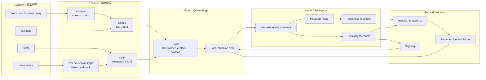
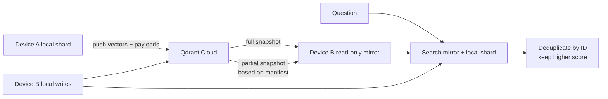

# 08. Conclusion：从本地向量记忆到完整的端侧 AI 助手

> 课程：Building AI Assistants with On-Device Memory  
> 本课定位：课程收束——回顾完整技术主线，检查是否真正掌握，并规划后续实践  
> 前置笔记：[07 Running on a Local Computer](07-running-on-a-local-computer.md)  
> 主要材料：[08 transcript](../transcripts/08-conclusion.md) · [课程官网](https://www.deeplearning.ai/courses/building-ai-assistants-with-on-device-memory) · [课程代码说明](../code/README.md)

## 1. 先说明：第 08 课实际讲了什么？

第 08 课 transcript 只有一句话：

> Congratulations on completing the course.

它没有引入新的模型、API、notebook 或实验。因此，本篇不是对一段不存在的技术讲解进行扩写，而是基于以下课程材料所做的**全课总结**：

- 01–08 的全部 transcripts；
- L3、L4、L5 三个核心实验 notebook；
- 课程代码仓库的 README 与 helper 实现；
- 第 07 课使用的完整实时应用及官方文档；
- 可选 Appendix：端侧记忆与云端同步。

后文会区分三类内容：

| 类型 | 含义 |
| --- | --- |
| 课程事实 | transcript、notebook、源码或官方页面直接展示的内容 |
| 课程归纳 | 把多节课的信息连接成统一模型 |
| 实践建议 | 为继续学习和动手开发整理的路线，不是第 08 课新增要求 |

## 2. 这门课最终让你获得什么能力？

课程官网把目标概括为三项：

1. 使用本地向量搜索，构建能够存储、检索、过滤和遗忘经历的端侧记忆系统；
2. 构建可从文字笔记、语音记录和图片中回忆信息的离线多模态助手；
3. 通过少量照片教会助手识别新对象，而不重新训练模型。

完成课程后，你应该能解释并实现下面这条主线：

```text
现实经历
  ↓ Capture
文本 / 语音 / 图片 / 摄像头画面
  ↓ Encode
Nomic / CLIP / Whisper
  ↓ Store
Qdrant Edge point = named vectors + payload
  ↓ Retrieve
语义近邻 + metadata filter + freshness reranking
  ↓ Decide
阈值判断：候选是否足够相似，能否算作识别
  ↓ Act
展示结果、记录 sighting、回答时间和位置
  ↓ Maintain
增加视角、改名、忽略、软遗忘或明确删除
```

这门课最重要的结论不是某一行 Qdrant API，而是：

> 一个 AI 应用可以通过更新外部记忆立即获得新知识，不一定需要 LLM，也不一定需要重新训练模型。

## 3. 全课系统全景



这张图包含两条容易混淆的路径：

- **Recall：** 用户提出问题，系统从文字、语音转写或照片记忆中找出相关经历；
- **Recognition：** 系统看到一个新画面，先检索最相似的已教学视角，再用 threshold 判断能否承认它是同一个对象。

两者都使用向量近邻搜索，但产品语义不同。

## 4. 01–08 课程知识地图

| 课程 | 核心问题 | 为系统增加的能力 | 笔记 |
| --- | --- | --- | --- |
| 01 Introduction | 为什么设备需要自己的记忆？ | 建立 capture、encode、store、recall、forget 的总框架 | [01](01-introduction.md) |
| 02 Overview | 文本和图片如何按含义被找回？ | Embedding、vector retrieval、CLIP 与 threshold | [02](02-overview-of-on-device-ai-memory.md) |
| 03 Inside the Device | 硬件、模型、存储和界面如何组合？ | 摄像头到本地 memory shard 的设备架构 | [03](03-inside-the-ai-assistant-device.md) |
| 04 Building the Memory | 如何创建最小可用记忆库？ | Point、named vectors、filter、delete 与 latency | [04](04-building-the-memory.md) |
| 05 Voice Assistant | 如何统一文字、语音和照片？ | Whisper、本地多模态 recall、新记忆即时可检索 | [05](05-building-the-voice-assistant.md) |
| 06 Learning Through Memory | 如何从少量照片学习并处理新旧记忆？ | 多视角教学、阈值校准、freshness reranking | [06](06-learning-through-memory.md) |
| 07 Local Computer | 如何把 notebook 原型变成实时应用？ | Detection、tracking、浏览器 UI、sightings 和记忆管理 | [07](07-running-on-a-local-computer.md) |
| 08 Conclusion | 课程最终形成了什么系统？ | 整理知识结构、验证掌握程度、选择下一步 | 本篇 |

前三课回答“为什么、是什么以及系统长什么样”；中间三课逐步实现记忆能力；第 07 课把离线 notebook 逻辑接入持续运行的摄像头应用。

## 5. 一条记忆到底是什么？

课程中的基本存储单位是 Qdrant `Point`：

```text
Point
├── id
├── vector / named vectors
│   ├── text: 768-d Nomic embedding
│   └── image: 512-d CLIP embedding
└── payload
    ├── 用户可读内容
    ├── source_type / kind / label
    ├── timestamp / location
    └── file / thumbnail / scene 等上下文
```

### 5.1 Vector 与 payload 分工不同

- **Vector** 负责“什么内容在语义或视觉上相似”；
- **Payload** 负责“这段经历具体是什么、何时发生、在哪里发生、来自什么媒介”；
- **ID** 让应用能够精确更新、删除和去重一条记忆。

只有原始文件，还没有语义检索能力；只有 vector，又无法向用户解释结果。一个可用的记忆系统通常同时需要二者。

### 5.2 Named vectors 为什么重要？

同一个 shard 可以包含多个向量空间：

| Vector name | 课程模型 | 维度 | 主要用途 |
| --- | --- | ---: | --- |
| `text` | Nomic text embedding | 768 | 文字/语音转写的语义检索 |
| `image` | CLIP | 512 | 图像相似度与文字搜图 |

一个 point 可以只有其中一个向量，也可以同时拥有两者。例如，L5 的 rubber-duck 记忆同时保存文字和图片向量，因此既能通过对象名称召回，也能通过新照片识别。

不同向量空间的维度、模型和分数分布不同，不能把 Nomic vector 送入 CLIP space，也不能把两个模型的原始 similarity score 直接横向比较。

## 6. 六组必须分清的概念

### 6.1 Retrieval 与 Recognition

| Retrieval | Recognition |
| --- | --- |
| 返回最相近的候选 | 判断候选是否真的属于同一对象 |
| 数据库非空时通常总能返回结果 | 可以通过 threshold 拒绝所有候选 |
| 回答“最像谁？” | 回答“它是不是？” |
| Top-1 不等于正确 | 需要 matches/non-matches 校准 |

L5 教学前，rubber duck 的最近邻是 bicycle，score 为 0.667。数据库正确完成了 retrieval，但如果把 top-1 直接当成 recognition，产品就会误判。

### 6.2 Semantic search 与 metadata filter

```text
Semantic search：含义接近什么？
Metadata filter：结果必须满足什么硬条件？
```

“找一个适合吃饭或喝东西的地方”适合 semantic search；“category 必须是 food 且 price 小于 15”适合 filter。过滤不会让记忆消失，只影响当前查询允许进入结果的候选。

### 6.3 Hard delete、soft forgetting 与 ignore

| 机制 | 是否删除 point | 主要效果 |
| --- | --- | --- |
| Filter | 否 | 当前查询排除不符合条件的候选 |
| Freshness / soft forgetting | 否 | 旧记忆保留，但排序优势降低 |
| Delete / Forget | 是 | 从后续查询中永久移除目标记忆 |
| Ignore | 写入负面视觉记忆 | 让实时应用持续隐藏某类无关物体 |

这四个动作不能互换。特别是实时应用中的 Ignore 并不是“删除未知物体”，而是记住以后继续忽略类似 crop。

### 6.4 Memory-based learning 与 model training

课程的 `teach` 流程是：

```text
参考照片 → CLIP vectors → 写入 points → 附加用户 label
```

它没有：

- 更新 CLIP 权重；
- fine-tune detector；
- 训练新的分类头；
- 调用云端模型。

因此，这是一种 exemplar-based recognition 或 memory-based learning。优点是样本少、立即生效、容易撤销；代价是识别质量高度依赖视角覆盖、crop、光照、阈值和参考数据质量。

### 6.5 Voice memory 与 spoken query

- **Voice memory：** 录音先由 Whisper 转写，课程保存 transcript 并将它作为可检索的文字记忆；
- **Spoken query：** 用户问题先被 Whisper 转成文字，再复用和 typed query 相同的 recall 函数。

Whisper 在这里是语音到文字的入口，不是一个新的 vector space。

### 6.6 On-device 与 cloud

核心课程选择 on-device，是为了：

- 不依赖网络即可召回；
- 避免每次查询的网络往返；
- 让私人经历默认保留在本地；
- 不要求云端数据库账户或 API key。

云端仍然适合多设备共享、更大存储或集中管理。二者可以组成 hybrid architecture，但加入云端后就必须重新处理认证、同步、冲突、网络失败和隐私边界。

## 7. 阈值不是一个可以到处复用的神奇数字

课程出现过多组阈值，它们服务于不同模型和不同阶段：

| 场景 | 课程数值 | 真实作用 |
| --- | ---: | --- |
| L4 text recall | 0.60 | 展示层区分较强与较弱文字结果 |
| L4 photo recall | 0.23 | 展示层区分较强与较弱图片结果 |
| L5 object recognition | 0.80 | 基于当前实验 matches/non-matches 选择的 cutoff |
| 实时应用 recognition | 0.90 | 对实时 crop 使用的更严格默认 cutoff |
| 实时 near-match margin | 0.05 | 0.85–0.90 只显示 guess，不算正式识别 |

这些数值不能直接解释成概率。例如 cosine similarity 为 0.90，不等于“模型有 90% 把握”。

正确的校准过程是：

1. 收集代表真实使用环境的正样本和负样本；
2. 用与生产环境完全相同的 crop、mask、encoder 和预处理生成分数；
3. 查看 match 与 non-match distributions；
4. 根据 false positive 与 false negative 的实际成本选择 cutoff；
5. 换摄像头、模型或预处理后重新校准。

课程 L5 使用 6 个 held-out matches 与 220 个 non-matches 选择 0.80。这个实验展示的是**选择方法**，不是为所有设备规定永久阈值。

## 8. 时间如何进入语义记忆？

纯语义相似度不知道哪条记忆更新。L5 中，旧 locker code `2280` 在语义上可能比新密码 `4471` 更接近问题，因此课程加入 freshness bonus：

```text
final score = semantic similarity + freshness bonus
```

课程实验使用：

- 7 天半衰期；
- 最多 0.2 的时间 bonus；
- 先按语义检索 20 个候选，再在候选内重排。

这种两阶段设计很重要：时间只能调整已经具有一定相关性的候选，不能让一条完全无关但刚刚写入的记忆无限上升。

它也说明 metadata 并非只用于硬过滤。时间、位置和来源等字段还可以参与 reranking、答案展示和记忆治理。

## 9. 从 notebook 到实时助手，增加了什么？

Notebook 处理有限、静态、由学习者明确提供的数据；实时应用必须持续处理开放环境。因此，第 07 课又加入：

- YOLOE：发现候选物体区域；
- BoT-SORT：在连续帧中维护 track；
- stable-frame gating：避免对瞬时检测立即判断；
- masked crop：减少背景对 embedding 的干扰；
- focus selection：决定当前可以教学哪个 unknown object；
- query cadence：避免每帧重复查询；
- sighting policy：避免每帧都写入记忆；
- 浏览器 UI：教学、提问、查看和管理记忆。

实时识别链路可以压缩为：

```text
Camera frame
→ detect object
→ track until stable
→ create masked crop
→ CLIP image embedding
→ search taught image vectors
→ apply recognition threshold
→ show label or unknown
→ write one sighting for the live track
```

Detector 只负责“哪里可能有对象”，用户教学的 memory 才负责“这个具体对象叫什么”。

## 10. 最终实时应用的三类记忆

| `kind` | 向量 | 含义 |
| --- | --- | --- |
| `taught` | image + text | 用户命名的参考视角 |
| `seen` | image | 已知对象后来再次出现的记录 |
| `ignored` | image | 用户要求持续忽略的视觉 clutter |

它们支持一套完整的记忆生命周期：

```text
Unknown object
  ├─ Teach → taught view
  │            ↓ recognized again
  │          seen sighting
  │            ├─ Rename
  │            ├─ Drop one view/sighting
  │            └─ Forget all taught + seen points
  └─ Ignore → ignored visual memory
                 └─ Unignore → delete ignored point
```

这里的“持续学习”不是无限写入。实时应用对同一 live track 只保存一次 sighting，并在回答时把十分钟内的相邻记录合并为一个 occasion，从而控制重复数据。

## 11. 为什么这个助手不需要 LLM？

课程需要解决的任务是：

- 找到语义相关的笔记；
- 找到符合文字描述的照片；
- 判断画面中的对象是否匹配已教学样例；
- 返回对象最后出现的时间和位置。

这些任务可以由 embedding、vector search、metadata 和模板回答完成。实时应用的答案来自已存的 label、timestamp、location 和 scene，而不是由 LLM 自由生成。

这带来两个好处：

- 答案更容易追溯到具体 memory point；
- 系统不会因为生成过程而凭空编造一个不存在的 sighting。

但“不使用 LLM”也意味着它不是通用对话 Agent：复杂推理、多轮意图理解、自然语言生成和工具规划并不在课程范围内。

如果未来加入 LLM，合理的架构应当是让 LLM 使用本地 memory retrieval 的结果，而不是让生成模型取代可验证的记忆层。

## 12. 本地运行不自动等于绝对隐私

On-device architecture 明显减少了把私人经历发送到远程服务的需要，但工程上仍需处理：

- shard、thumbnail、scene 和 transcript 是否加密；
- 操作系统上的其他用户能否读取数据目录；
- 浏览器 UI 是否只绑定受信任网络接口；
- 手机访问时 HTTPS 与麦克风权限是否正确配置；
- 日志、备份或 crash report 是否意外包含敏感内容；
- Forget 是否满足产品所承诺的数据删除语义；
- 云端同步开启后，用户是否理解数据将离开设备。

因此，“数据默认留在设备上”是有价值的架构基础，但不是完整的安全与隐私保证。

## 13. 可选 Appendix：本地与云端的混合记忆

课程代码还提供了可选 notebook：

- [Appendix：A Hybrid of On-Device and Cloud Memory](../code/Appendix/Appendix.ipynb)

它不是第 08 课的新核心要求，而是课程结束后的扩展方向。主要流程是：



其关键模式是：

- 每台设备保留一个可立即写入的 local shard；
- 再保留一个通过 snapshot 更新的 read-only cloud mirror；
- 新记忆先在本地可用，同时推送到 cloud；
- 查询同时搜索两个 shards，并按 point ID 去重；
- partial snapshot 只传输设备缺少的 segment 变化。

运行云端部分需要 Qdrant Cloud 账户、cluster URL 和 API key。Notebook 允许留空凭证，以便只阅读同步模式而不上传任何记忆。API key 不应写入或分享在 notebook 中。

## 14. 一份最小的课程复现实践路线

如果想确认自己不只是“看懂了”，可以按以下顺序复现。

### 阶段 A：本地文本与图片记忆

使用 [L3 notebook](../code/L3/Lesson3.ipynb)：

1. 创建包含 `text` 和 `image` named vectors 的 shard；
2. 写入文字 points；
3. 完成语义查询与 metadata filtering；
4. 加入图片并用文字检索；
5. 删除一条 point，并验证后续查询不再返回它。

### 阶段 B：多模态日常回忆

使用 [L4 notebook](../code/L4/Lesson4.ipynb)：

1. 在本地转写 voice notes；
2. 统一存储 text、voice transcript 与 photos；
3. 用 typed question 搜索三类记忆；
4. 用 spoken question 复用同一个 recall；
5. 新增一条记忆并立即找回。

### 阶段 C：教学、识别与时间重排

使用 [L5 notebook](../code/L5/Lesson5.ipynb)：

1. 分离 teaching views 与 held-out test views；
2. 比较教学前后的 nearest neighbor；
3. 根据 match/non-match 分布选择 threshold；
4. 构建同时包含文字和图片的 assistant shard；
5. 用 freshness 修正“旧信息比新信息排得高”的问题；
6. 关闭并重新加载 shard，验证持久化。

### 阶段 D：运行实时应用

参考 [第 07 课笔记](07-running-on-a-local-computer.md)：

1. 在普通电脑上运行官方应用；
2. 从多个角度教学一个具体对象；
3. 让对象离开并重新进入画面；
4. 检查 recognition 与 sighting；
5. 重启应用并确认记忆仍在；
6. 分别测试 Rename、Drop view、Ignore 和 Forget。

## 15. 推荐的个人项目递进路线

以下是基于课程能力的实践建议，不是课程原始作业。

### 项目 1：离线个人物品助手

- 只识别 3–5 个具体物品；
- 保存最后出现时间和位置；
- 提供明确的 Forget；
- 记录误识别案例并重新校准 threshold。

重点不是增加对象数量，而是建立完整评估流程。

### 项目 2：可审计的生活记忆库

- 加入自定义 `source_type`、location 和 privacy level；
- 组合 semantic search 与 metadata filter；
- 为旧信息设计 freshness 或 expiration policy；
- 每条回答都显示其来源 point。

### 项目 3：多设备共享记忆

- 使用 Appendix 的 local-write + read-only-mirror 模式；
- 明确离线时的行为；
- 设计重复 ID、同步延迟和删除传播策略；
- 在开启云同步前提供清晰的用户授权。

## 16. 课程完成自检

如果能独立回答并演示以下内容，就真正掌握了课程主线：

- [ ] 能画出 capture、encode、store、recall、forget 的数据流；
- [ ] 能解释 embedding、named vector 与 payload 的职责；
- [ ] 能创建并重新加载一个持久化的 Qdrant Edge shard；
- [ ] 能用文本语义检索，并与 metadata filter 组合；
- [ ] 能说明 Nomic 与 CLIP scores 为什么不能直接比较；
- [ ] 能把本地 Whisper transcript 作为文字记忆检索；
- [ ] 能解释 retrieval 与 recognition 的区别；
- [ ] 能用 held-out samples 校准 threshold，而不是凭感觉选择数值；
- [ ] 能说明多视角教学为何不是 fine-tuning；
- [ ] 能使用 freshness 处理新旧语义记忆冲突；
- [ ] 能区分 filter、soft forgetting、delete 与 ignore；
- [ ] 能解释 detection、tracking 与 memory recognition 的分工；
- [ ] 能说明本地架构的优势、局限和剩余隐私风险；
- [ ] 能在不使用 LLM 的情况下解释系统如何回答“最后在哪里看到它”。

## 17. 常见误区总表

| 误区 | 正确理解 |
| --- | --- |
| 最近邻就是正确答案 | 最近邻只是候选，识别还需要 threshold |
| Score 0.90 就是 90% 概率 | 它是当前向量空间中的 similarity，不是校准概率 |
| 添加照片就是训练模型 | 课程只是写入新的 exemplar vectors |
| 所有 embedding 都能互相搜索 | 查询与数据必须位于兼容的向量空间 |
| 多模态结果可以按原始 score 混排 | 不同模型的分数分布通常不可直接比较 |
| Filter 会让数据库忘掉数据 | Filter 只限制查询；Delete 才移除 point |
| Soft forgetting 等于删除 | 它只通过重排降低旧记忆优先级 |
| Ignore 等于 Forget | Ignore 保存负面视觉样例；Forget 删除已知对象记忆 |
| 每一帧都应该成为记忆 | 实时应用需要 tracking、节流和 occasion grouping |
| On-device 自动解决全部隐私问题 | 本地文件权限、UI 暴露、日志和同步仍需治理 |
| 语音助手一定需要 LLM | 语音转写、向量召回和模板回答可以独立完成 |
| 课程阈值能直接用于我的摄像头 | 环境、crop、模型或预处理改变后都应重新校准 |

## 18. 综合复习问题

1. 为什么原始照片文件与可检索的图片记忆不是同一个概念？
2. Vector、payload 与 point ID 各自解决什么问题？
3. 为什么一个 shard 可以同时存放只有 text vector 和只有 image vector 的 points？
4. Document embedding 与 query embedding 为什么不应随意互换？
5. 用文字搜索照片时，CLIP 的两个 encoder 如何协作？
6. 为什么 top-1 nearest neighbor 不能直接作为 recognition 结果？
7. 如何用正负样本选择 threshold？它过高或过低分别带来什么错误？
8. 为什么 L4、L5 和实时应用中的阈值不能互相替换？
9. 多视角教学如何扩大同一对象在向量空间中的覆盖？
10. 为什么 held-out test view 不能同时作为 teaching view？
11. Voice note 与 spoken query 在数据生命周期中有什么差别？
12. Semantic search 与 metadata filter 应如何组合？
13. 为什么 freshness 应只重排语义候选，而不作用于全部记忆？
14. Filter、soft forgetting、delete 与 ignore 的数据后果分别是什么？
15. YOLOE、BoT-SORT、CLIP 与 Qdrant Edge 在实时链路中各负责什么？
16. 为什么同一 live track 不应每帧写入一个 sighting？
17. Rename 为什么需要更新文字向量，却通常不需要更新图片向量？
18. 在没有 LLM 的情况下，系统如何回答“最后在哪里看到我的杯子”？
19. 本地运行提供了哪些隐私优势，又留下哪些安全责任？
20. 如果扩展到多设备同步，本地写入与只读 mirror 为什么应该分开？

## 19. 最终总结

这门课构建的不是一个依靠巨大模型“记住一切”的系统，而是一层明确、可检查的外部记忆：

```text
经历被捕获
→ 模型把经历编码成向量
→ 向量与上下文一起保存在设备上
→ 问题或新观察触发近邻检索
→ filter、freshness 与 threshold 把候选变成决定
→ 用户可以继续教学、修正或遗忘
```

它展示了一个非常实用的工程观点：

> 模型负责表示，向量库负责记忆，metadata 负责上下文，应用策略负责决定什么时候相信、保存和遗忘。

当这四层职责清楚分开时，同一套 memory loop 就能从 notebook 迁移到个人电脑、机器人、智能眼镜、家庭设备或现场终端。

至此，课程 01–08 的主线完成。

## 资料来源

- [08：Conclusion transcript](../transcripts/08-conclusion.md)
- [DeepLearning.AI：Building AI Assistants with On-Device Memory](https://www.deeplearning.ai/courses/building-ai-assistants-with-on-device-memory)
- [课程代码说明](../code/README.md)
- [L3：Building the Memory](../code/L3/Lesson3.ipynb)
- [L4：Building the Voice Assistant](../code/L4/Lesson4.ipynb)
- [L5：Learning Through Memory](../code/L5/Lesson5.ipynb)
- [Optional Appendix：A Hybrid of On-Device and Cloud Memory](../code/Appendix/Appendix.ipynb)
- [01 Introduction 笔记](01-introduction.md)
- [02 Overview of On-Device AI Memory 笔记](02-overview-of-on-device-ai-memory.md)
- [03 Inside the AI Assistant Device 笔记](03-inside-the-ai-assistant-device.md)
- [04 Building the Memory 笔记](04-building-the-memory.md)
- [05 Building the Voice Assistant 笔记](05-building-the-voice-assistant.md)
- [06 Learning Through Memory 笔记](06-learning-through-memory.md)
- [07 Running on a Local Computer 笔记](07-running-on-a-local-computer.md)
